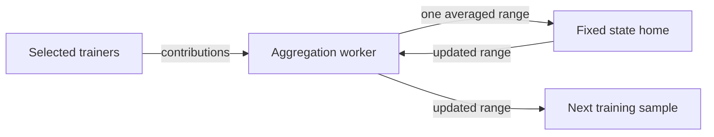

# Conflux V2 research

This branch adds Conflux V2 to the shared simulator on `main`. Shared execution
optimizations and literature baselines remain the same code on both branches.
Conflux V2-specific implementation lives in `dasklearn/simulation/conflux_v2/`;
its registration, CLI options and runner support are the small integration layer.

## Protocol

A reproducible sample trains from the current aggregate. A temporary coordinator
agrees on one contributor set, containing the first
`ceil(sample_size * success_fraction)` ready contributors. Every chunk reducer
uses that same set. Each contributor uploads a chunk once to its designated
reducer; the reducer averages contributors in a fixed order and sends the result
to each recipient in the next sample. Those recipients reconstruct the same
sample aggregate. Reducer assignment balances chunk load relative to public
bandwidth capacities and may use nodes outside the training sample.

With full participation within a sample (`success_fraction=1`),
`--immediate-uploads` starts each contributor's uploads as soon as local training
finishes. The contributor set is already known, so the readiness/plan exchange
can be skipped. Reducers still wait for every contributor. This optimization is
opt-in; partial-success rounds retain the coordinated path. `--relay-count` caps
potential reducers; the chunk count determines how many chunks can be placed.

Stable membership is required. Offline-node recovery, coordinator/reducer failure
and membership changes are not implemented. Partial-success selection can bias
learning when speed and client data correlate. Chunking and aggregation compute
are instantaneous in simulated time, consistent with the baseline conventions.

## Running

Small CPU validation:

```sh
python scripts/validate_algorithms.py --variants shatter-r2 conflux-v2 moshpit \
  --peers 8 --sample-size 4 --chunks 4 --relay-count 4 --immediate-uploads \
  --profiles heterogeneous --partitioners iid --seeds 0 \
  --duration 10 --test-period 2 --output output/v2-smoke-new
```

CIFAR-10 with the optimized 16-trainer/chunk/reducer configuration:

```sh
python scripts/run_cifar.py --output output/cifar-v2-new \
  --dataset-base-path /path/to/cifar-cache --variants conflux-v2 moshpit \
  --profiles uniform heterogeneous --partitioners iid dirichlet --seeds 0 1 2 \
  --peers 64 --sample-size 16 --chunks 16 --relay-count 16 --immediate-uploads \
  --duration 900 --test-period 150 --alpha .1 --learning-rate .01 \
  --momentum 0 --local-steps 5 --device cuda:0
```

The coordinator also supports `--algorithm conflux-v2`. Its chunk flag is
`--chunks-in-sample`; comparison runners use `--chunks`. CUDA residency/batching
opt-outs and reference fallbacks are inherited from main. Use fresh output paths:
source hashes change when code is reorganized even if protocol math does not.

## Evaluation and correctness

The primary readout is mean accuracy/loss across all nodes' stored completed
checkpoints at a fixed simulated time. It includes idle sampled nodes' older
checkpoints. The latest completed V2 sample aggregate is a separate quantity,
identified by the maximum recorded round; all recipients of that round must
have identical metrics. `latest-aggregate.csv` retains that readout and node
staleness. Selected trainers receive the current round input before training;
older stored node checkpoints do not imply stale-gradient training.

`tests/test_conflux_v2.py` contains the V2-specific numerical, compute-serialization,
streaming, reconstruction-cache and batched-execution checks separated from the
shared tests. `tests/test_conflux_v2_overlap.py` checks immediate uploads, reducer
placement, contributor ordering and partial-success fallback. Run the complete
maintained suite with `python -m pytest` on this branch.

## Research records

- [Baseline comparisons and upload/reducer ablations](experiments/peer-baselines.md).
- [DSpodFL comparison](experiments/dspodfl.md).
- [DeMo comparison](experiments/demo.md).
- [QG momentum comparison: fresh one-step CIFAR-10 matrix](experiments/qgm.md).
- [Original research log, including Tiny ImageNet and execution optimizations](experiments/research-log.md).
- Compact results, manifests, plots and audit scripts retain their original
  paths under `output/`. Raw DAGs and per-node files remain in the server paths
  recorded by those manifests.

The original archive branch is unchanged. Existing frozen execution directories
on sacs006 were not edited. Historical metrics still refer to their original
commits/source hashes; this branch layout does not relabel them as fresh results.
Generic changes belong on `main` first, then merge into this branch.

After separation, this branch passes 139 maintained tests on macOS/CPU (six
CUDA skips) and all 145 on Linux/CUDA on sacs006. A fresh three-protocol smoke
run executes Shatter, full-sample immediate-upload V2 and Moshpit, preserving
complete per-node snapshots. These are reorganization regression checks, not
new convergence experiments.

## Current main integration and expanded study

The 31 October 2026 integration rebases the research delta onto main `bda202a`
and migrates V2 to explicit task references and main's compute/payload APIs.
The original full history is retained at `codex/conflux-v2-before-rebase`;
historical records keep their original provenance. V2 settings work with the
shared YAML/JSON runner, including independent controlled capacity profiles.
See [the expanded study](experiments/convergence-20261031.md) for the four
workloads, six algorithms, validation-only tuning, and paired confirmation plan.

## Reducer-side server optimizers (experimental)

The `codex/conflux-v2-fedopt` branch adds `server_optimizer: fedavgm` and
`server_optimizer: fedadam`. The default remains the original FedAvg protocol.
Each optimizer shard retains the current base weights and its own moment history;
trainers continue to use ordinary local SGD. Server pseudo-gradients are the base
minus the common, uniformly averaged client model. FedAvgM uses unnormalized SGD
momentum. FedAdam uses EMA first/second moments, `v0 = server_tau**2`, no bias
correction, and denominator `sqrt(v) + server_tau`, following FedOpt Algorithm 2.
Non-parameter buffers are averaged rather than optimized; LoRA is unsupported.

`reducer_epoch_rounds: 0` fixes chunk ownership, `1` preserves per-round rotation,
and larger values retain a layout for that many logical rounds. At an ownership
change the previous owner sends the base chunk, moments and logical step to the
new owner through the normal contended network. The new owner waits for that
state and all contributors before updating. State is never broadcast to trainers.

`state_bits: 8` quantizes moments only on handoff, using independent blocks of
`state_block_size` elements. First moments use signed symmetric int8 and second
moments nonnegative uint8, each with FP32 block scales. Owners compute in FP32;
base weights stay FP32. Wire size includes those arrays, scales, an eight-byte
step counter, and the shared API's normal header/metadata charge. Every recipient
still reconstructs the same model even when moments are approximate.

`server_step_ms` charges CPU optimizer time per chunk on a serialized optimizer
resource; `state_pack_ms` charges quantization time per migrated chunk. Defaults
are zero, retaining the simulator's original instantaneous aggregation convention.
The experimental comparison explicitly charges 0.1 ms and 0.05 ms respectively;
these are controlled costs, not measurements of an edge device.

The regular version-1 configuration in
`experiments/conflux-v2/fedopt/tuning.json` describes a 64-node, 16-trainer,
128-chunk/16-reducer CIFAR-10/GNLeNet study, non-IID alpha 0.1, joint network/compute
heterogeneity and 900 simulated seconds. It gives server SGD (FedAvgM beta1=0),
server momentum and FedAdam equal twelve-candidate client/server-rate searches on
validation seed 10011. Rates are selected by validation accuracy area, then frozen
for seeds 0/1/2. Confirmation compares fixed owners, FP32/8-bit rotating handoffs,
eight-round ownership epochs, original fixed/rotating FedAvg and Moshpit. Full
final test scores are never used to select rates. Network and CPU costs are charged
in protocol time; GPU execution wall time is separate.

```sh
python scripts/benchmark_conflux_fedopt.py --stage plan --output /path/to/fedopt-results
python scripts/benchmark_conflux_fedopt.py --output /path/to/fedopt-results --gpus 0 1
# Repeat an identical command to resume; changed source/settings are rejected.
python scripts/benchmark_conflux_fedopt.py --stage status --output /path/to/fedopt-results
```

Tests compare every chunked round to independently calculated full-vector FedOpt,
check state/round ownership, exact byte savings of actual quantized packets, common
recipient models, partial participation, charged compute, and validation-only rate
selection. Scheduled handoff payload totals are separate from actual transmitted
bytes: a time-limited run can stop while a transfer is still pending or in flight.

### First FedOpt study results

The committed implementation `006939a` completed all 36 validation candidates and
27 confirmation runs on sacs006 under `/mnt/data/mdevos/conflux-fedopt-20261102`.
All three selected client learning rates were 0.01. Selected server rates were 1
for SGD, 0.3 for momentum and 0.01 for Adam. Adam used beta1=0.9, beta2=0.99 and
tau=0.001. The complete server suite passed 455 tests; CUDA reference checks also
passed. Original rotating FedAvg and Moshpit reproduce all six previous runs'
final per-node test accuracy/loss and recorded round IDs exactly.

Full final test accuracy after 900 simulated seconds, mean ± sample SD over seeds
0/1/2, across all 64 stored node checkpoints:

| Variant | Test accuracy |
| --- | ---: |
| Original FedAvg, fixed owners | 37.74 ± 1.87% |
| Original FedAvg, rotating owners | 37.68 ± 1.81% |
| Validation-tuned server SGD, fixed owners | 37.72 ± 1.88% |
| FedAvgM, fixed owners | 42.15 ± 1.48% |
| FedAdam, fixed owners | 43.71 ± 0.85% |
| FedAdam, rotating FP32 handoffs | 43.63 ± 0.87% |
| FedAdam, rotating 8-bit handoffs | 43.65 ± 0.87% |
| FedAdam, eight-round epochs / 8-bit handoffs | 43.63 ± 0.85% |
| Moshpit, group 8 / one phase | 29.04 ± 2.48% |

At the 35% validation target, original FedAvg's first-observed times are
600/750/900 seconds, tuned server SGD's 600/700/900, and fixed-owner Adam's
500/500/450. Adam's median paired observed speedup is 1.5x against original FedAvg
and 1.4x against tuned SGD; all three first-crossing checkpoint intervals are
separated. Checkpoints are 50 seconds apart. Adam reaches 40% validation at
550/600/750 seconds; both non-adaptive baselines are censored at that target.
These are validation-subset targets, distinct from final full-test scores. Adam
does not improve every earlier target in every seed.

Rotating 8-bit handoffs schedule 10.22 MB of state payload on average versus
20.48 MB for FP32, including the uncompressed base weights. Actual total traffic
at 900 seconds falls from 941.37 MB to 929.57 MB (1.25%). Eight-round epochs reduce
scheduled handoff payload further to 1.38 MB. Quantization retains similar final
accuracy here; state movement is a modest share of total traffic, so its speed
benefit is smaller than the optimizer's convergence benefit. Scheduled payload
counts and actual transmitted bytes are separate measurements.

Compact curves, per-run metrics, paired speedups, plots, frozen source,
configuration files and audits are in `output/conflux-v2-fedopt-20261102`.
`experiments/conflux-v2/fedopt/fedadam.json` reproduces the selected fixed-owner
configuration; `fedadam-rotating-int8.json` and `fedadam-sticky-int8.json` reproduce
the handoff variants. These results support the optional optimizer in this one
stable-membership regime and horizon; they do not establish general superiority
across data/models or measured real-device runtimes. FedAvg remains the default.

## Publication direction and next research steps (2 November 2026)

Recorded following discussion with the user. Offline support and churn recovery
are deferred. Stable membership is an acceptable scope for the next study. The
user wants to avoid manually tuning chunk counts, reducer counts and placement
for each deployment.

### Novelty assessment

Static parameter-shard reducers alone are not a defensible main novelty claim.
P2Sharding already distributes a federated model across independent parameter
servers, including servers colocated with clients. DeTA partitions federated
updates among multiple aggregators. ZeRO establishes optimizer-state sharding;
FedOpt establishes the server optimization rule. These are architectural and
algorithmic overlaps, not evidence that every detail of Conflux has appeared in
one prior protocol. This is a targeted literature review, not an exhaustive
novelty determination.

With a common base model, round, contributor set and aggregation weights, each
Conflux shard computes the corresponding centralized FedOpt coordinates, apart
from floating-point ordering. Fixed owners keep moments local without changing
that rule. Optimizer gains and systems gains must therefore be separated; beating
Moshpit alone does not isolate a new sharded aggregation contribution.

### Next baseline

Implement a conventional synchronous sharded parameter-server baseline with the
same trainer samples, contributor sets, local SGD, server optimizer, aggregation
weights, payload precision, network contention and compute accounting. It should
support the same reducer budget, including peer-hosted reducers and overlapping
trainer/reducer roles. Check full-vector optimizer equivalence on a common update
trace before comparing end-to-end execution.

Use controlled ablations for immediate versus barriered uploads, chunk streaming,
placement and dissemination to the next sample. Do not handicap the baseline by
forcing every conventional server to wait for unrelated chunks or to broadcast
to idle peers; include equivalent optimizations where applicable. Distinguish a
simple baseline from an optimized matched baseline. Compare equal tuning budgets
and charge startup profiling, exploration and scheduling overhead to the run.

### Candidate contribution: automatic scheduling under shared peer resources

Research hypothesis, not an established novelty claim: jointly selecting reducer
resources, shard placement and transport granularity from observed conditions can
reduce time to target accuracy while preserving the sampled FedOpt trajectory.
Generic autotuning, transfer prioritization and spare-resource aggregation already
exist; the proposed distinction must address Conflux's combination of shared
trainer/reducer NICs, changing source/destination cohorts and persistent optimizer
ownership. Establish this distinction against relevant schedulers before claiming
it as new.

Proposed first scope:

1. Keep sample size, sampling distribution, local steps and optimizer settings
   fixed. Use all selected contributors. Optimize systems choices without adding
   selection bias when client speed correlates with non-IID data.
2. Measure training completion times, effective upload/download service rates,
   per-message overhead and reducer compute using startup probes and observed
   traffic. Use only causally available measurements; no simulator-future oracle.
3. Predict when the next cohort has complete input models, accounting for upload
   release times, inbound and outbound contention, overlapping node roles,
   serialization and message overhead. Select reducer count, unequal shard loads
   and transfer sizes jointly rather than choosing the fastest nodes alone.
4. Initially select owners automatically at startup and keep them fixed. Separate
   logical optimizer shards from transport packets so packet coalescing/splitting
   can adapt without moving moments. This is a design proposal, not implemented
   behavior. Group only compatible data for an owner; receivers must track chunk
   and round completeness and preserve numerical semantics.
5. Update predictions from residual errors and make conservative changes with
   measured benefit. If later allowing owner changes, charge weights, moments,
   metadata and packing costs, and require predicted savings over a reasonable
   horizon to exceed those costs. Such an extension is occasional reassignment,
   not the fixed-owner protocol.

The first objective is elapsed round/pipeline time for fixed statistical work.
Evaluate final accuracy at fixed time and time to target afterward. Faster rounds
alone do not establish convergence improvements. Learning rates and other
statistical hyperparameters remain separate; this proposal does not eliminate
all training hyperparameters.

Evaluate on held-out capacity profiles, larger models and different bottlenecks,
including stable slowdowns without membership failures. Compare fixed defaults,
a capacity-weighted heuristic, a generic online tuner, the proposed scheduler,
and the best fixed configuration found in an offline sweep as a labelled
hindsight reference, not an online competitor. Freeze policies before final
tests. Include controller overhead in the 900-second budget, realistic latency
and per-message costs, and a real distributed prototype before making practical
runtime claims. Report cases with little available scheduling headroom as well
as wins. A cost model, lower bound in a stated resource model, or a characterized
scheduling tradeoff would strengthen the contribution beyond a parameter search.

### Relevant primary sources

- [P2Sharding: Towards Decentralized Parameter Servers for Secure Federated Learning (DATA 2022)](https://www.scitepress.org/PublishedPapers/2022/111463/111463.pdf).
- [DeTA (EuroSys 2024)](https://gzs715.github.io/pubs/DETA_EUROSYS24.pdf).
- [ZeRO (SC 2020)](https://arxiv.org/abs/1910.02054).
- [Adaptive Federated Optimization (ICLR 2021)](https://arxiv.org/abs/2003.00295).
- [BytePS (OSDI 2020)](https://www.usenix.net/system/files/osdi20-jiang.pdf): spare CPU/bandwidth resources; its summation servers are not equivalent to FedAdam state owners.
- [TicTac (MLSys 2019)](https://proceedings.mlsys.org/paper_files/paper/2019/hash/94cb28874a503f34b3c4a41bddcea2bd-Abstract.html): communication scheduling.
- [Horovod autotuning documentation](https://github.com/horovod/horovod/blob/master/docs/autotune.rst): online search over communication parameters, including fusion size.
- [Oort (OSDI 2021)](https://www.usenix.org/conference/osdi21/presentation/lai): participant selection for time to accuracy; relevant if later changing trainer selection.

This records a proposed research direction and a baseline to implement next.
The baseline and automatic scheduler have not been implemented or evaluated.

## Conflux V3 design draft: automatic sharding and scheduling

Design discussion, 2 November 2026. This section is a proposal, not implemented
behavior or an established novelty claim. The user requested startup profiling,
shared measurements, few manual parameters, changing training samples, feedback
under inaccurate predictions and occasional timing hiccups, and stable membership
for the first version. Churn resilience remains a later extension.

### Scope and statistical contract

Keep the existing public seeded sample sequence: S_t trains from x_(t-1), and
D_t = S_(t+1) receives x_t. Samples change every round and need not include any
particular reducer. Preserve sample size, local steps, client/server optimizer
settings, contributor weights, and all selected contributors. Every coordinate
uses that same set and base version. Scheduling decisions must not select faster
contributors or change local work. A recipient trains only after receiving the
whole common model; recipients may start at different wall-clock times.

The systems objective is the time at which the next cohort can proceed, including
overlap with training and other rounds. Use per-recipient model-ready times plus
their predicted local training times when evaluating a short pipeline lookahead;
do not optimize bytes/second in isolation or insert a new global start barrier.
Per-round numerical equivalence to reference FedOpt is a correctness requirement,
not a claim of identical fixed-time accuracy.

### Separate persistent state from aggregation work

Moving a stateful chunk between reducers moves its optimizer history. To permit
runtime load balancing without repeatedly migrating moments, give each parameter
range a fixed state home, but permit a different node to execute its aggregation
job. A home stores base weights, moments and logical step for its ranges. It need
not hold the full model or belong to either training cohort.

The direct path is unchanged: contributors -> home -> next cohort. A helper path
for one range is:



The worker collects the common contributors, averages in their agreed order,
sends one averaged range to its home, receives the optimized range, and fans it
out. The home executes FedOpt exactly once for that round/range. If worker and
home are the same node, both internal hops disappear. If a home or worker belongs
to the destination cohort, reuse its available updated range rather than sending
it over the network. Moments are neither sent to workers nor synchronized among
them. Non-parameter buffers retain the reference aggregation semantics.

This is optional offloading selected per job by the scheduler, not a compulsory
extra path for every chunk. Fixed homes can still bottleneck; they perform at
least optimizer work and communication with remote workers. This separation does
not remove a slow or failed home's critical dependency.

For m contributors, d recipients, range size b, worker w and home h, payload wire
volume is:

    b * (m - 1[w in S] + 2*1[w != h] + d - |D intersect {w,h}|)

Ignore headers only in this accounting identity; include them in scheduling.
Without endpoint overlap, remote help adds two b-sized transfers to (m+d)*b:
6.25% at m=d=16. Co-location changes that comparison: if the home is in both
cohorts and the helper in neither, the increase is 30b -> 33b, or 10%. Additional
latency can matter more than bytes. A sanity enumeration checked the identity
against explicit transfers for 8,100 small-cohort configurations; this is not a
performance experiment. The helper path must demonstrate a net benefit.

### Startup preprocessing

Profile the actual model/local-work configuration on each node, with separate
warmup and repeated timing observations. Probe effective upload/download service,
latency, per-message overhead, aggregation/optimizer throughput and available
buffer/state memory. Interference-controlled pairings and representative fan-in,
fan-out and overlapping-role tests are more useful than a single isolated link
measurement. Prefer an endpoint-capacity model initially; validate its residuals.
If shared links or pair-specific paths dominate, the model needs those constraints.
Do not infer arbitrary network topology from one scalar rate per node.

Share the compact measured profiles and their variation. Profiles are estimates,
not reservations or exact simulator capacities. In simulated evaluations obtain
them from charged probes/observed completion events, not hidden bandwidth limits
or future finish timestamps. Profiling must not alter the training model, data
position or RNG stream. Charge its simulated time, traffic and compute; report
warm-start results separately if useful. Existing prescribed optimizer costs are
controlled assumptions, not device measurements.

Choose a fixed home layout by balancing predicted optimizer and network loads,
subject to memory, with a simple fluid allocation as a warm start. For a direct
layout with x_i model bytes at node i, model size M, sample indicators s_i and d_i,
and cohort sizes m and d, exact payload loads for a round are:

    outgoing_i = s_i*(M-x_i) + (d-d_i)*x_i
    incoming_i = (m-s_i)*x_i + d_i*(M-x_i)

Together with sum(x_i)=M, capacity and memory constraints, these give a small
linear load-balancing relaxation. For uniform sampling use expected indicators
m/N and d/N to avoid designing homes just for the first cohort. This relaxation
ignores release times, messages and dependencies; it is not an optimal schedule.
Evaluate/prune tiny allocations using a predictor that includes those costs.
The number of nonempty homes emerges from the allocation, rather than a manual
reducer-count cap. Memory, dtype alignment and measured costs remain constraints.

Separate home ownership boundaries from job and packet boundaries. A home owns
coordinate intervals; each round splits these intervals into disjoint jobs.
Choose job sizes from a cost model of message overhead versus pipeline/tail delay,
and check nearby geometric sizes. In a simplified model T(b)=T_fluid+A/b+B*b,
the starting size is sqrt(A/B); A and B must come from the measured workload,
not fitted on final accuracy. This is a heuristic initialization, not a universal
chunk-size formula. Splitting and coalescing stay within a home and preserve
coordinate identity and numerical semantics. Job count is then an output.

Choose buffering/concurrency from the same model, transport capabilities and free
memory, not an arbitrary unlimited request queue. One outstanding job per worker
can be too restrictive: it may prevent early contributors uploading other ranges
while a job waits for a late contributor. The predictor must account for partial
collections and choose enough bounded prefetch to retain that overlap.

### Runtime scheduling

For a first implementation use a temporary control-plane planner, as V2 already
uses a coordinator. It does not aggregate model data or store all optimizer
state. Public membership, samples, profile snapshots and home directory can be
shared; live workers report credits/backlog to the planner. Fully decentralized
online planning is a separate problem. Stable membership does not itself make
this control plane failure tolerant.

Before local work finishes, prepare job descriptions and initial assignments so
immediate uploads can overlap other trainers' computation. A worker advertises
free receive/buffer capacity and outstanding outbound work. When granting an
unclaimed job, score candidate workers, always including its home, using predicted
completion through collection, home update and recipient delivery. Include:

- Actual readiness of contributions; predicted times only for unready inputs.
- Both endpoints' remaining send/receive loads and transport concurrency.
- A node's simultaneous trainer, home, worker and next-recipient roles.
- Both extra helper hops, home optimizer service, headers/control and processing.
- Recipient model completeness and next-round critical work.

Use a greedy earliest-completion allocation with a resource-respecting event/load
predictor, deterministic tie breaks and the direct home as the conservative tie
choice. This is a specified heuristic direction; deriving its precise score and
validating its prediction accuracy are implementation tasks. It is not an oracle
or an optimality guarantee. Prefer a helper only when predicted benefit exceeds
the empirical prediction-error margin for the direct/helper comparison. Initially
use one residual scale per affected stage; this is a fixed policy convention,
not a statistical confidence guarantee.

Grants identify round, coordinate interval, home, worker, contributor-set digest
and plan version. Route instructions reach all contributors before they upload
that job. A job is pinned once granted; do not redirect its partial collection
to another worker in the first version. Feed updated conditions into subsequent
grants. Speculative duplicate collection and timeouts are later extensions.

Dispatch ready transfers whenever real transport credits are available. Predicted
times guide priorities, not mandatory start times: a late operation must not
stall unrelated ready work, and a blocked receiver must not reserve idle bandwidth.
Prefer old unfinished rounds and critical model tails; provide deterministic
tie-breaking/fairness so later work cannot starve an earlier model. Do not assume
the existing bandwidth scheduler can preempt transfers or enforce arbitrary rate
reservations; V3 needs a protocol-level eligibility/dispatch queue.

The active worker count is the number actually receiving jobs. It can vary with
cohorts and measured conditions, without an exposed R parameter. Homes stay fixed
in this draft; the worker assignment, job geometry and transfer order adapt.

### Feedback and imperfect predictions

Maintain robust service and prediction-error estimates. A concrete first policy
is a rolling median and median absolute deviation over the last five endpoint
summaries, with at most one comparable summary per endpoint per logical round.
Keep training durations separately. Five is an internal algorithm constant,
not a claim that the mechanism has no parameters; test sensitivity to this choice.
Until enough observations exist, retain the startup profile and its uncertainty.

Do not turn every slow flow into a lower endpoint capacity: queueing, the remote
endpoint and application starvation also reduce flow throughput. Update endpoint
service estimates from attributable saturated observations, or fit residuals of
the contention model; keep queueing/readiness as distinct observations. If an
endpoint has no informative traffic, lack of observations is not proof of failure
or increased capacity. Start conservatively and collect new probes only when
their expected benefit justifies their measured cost.

Use live progress/queued bytes for short-term routing and robust summaries for
longer-term service estimates. An isolated hiccup reduces new work sent to that
worker without permanently treating it as slow; repeated slow observations
eventually change its measured service. This is a heuristic response, not a bound
on latency under arbitrary stalls. Correlated slowdowns and stale measurements
must be evaluated explicitly. Never keep following an absolute-time plan after
its assumptions have become false.

Keep queued work bounded so errors affect a limited amount of newly assigned
work. A granted job can still be delayed by its worker. With all contributors
required, a delayed selected trainer can still delay every chunk. A delayed home
can still delay its ranges. Scheduling cannot remove those dependencies while
preserving the chosen update; replication/retry or changed training semantics
would be needed to do more.

### Invariants, parameters and future recovery

Homes apply the correct global FedOpt step once per coordinate/round, not once
per transport packet. They accept only the common contributors' ordered mean
for a disjoint, authorized interval. Record completion intervals so repartitioning
cannot double-apply overlapping coordinates. Preserve the previous step's state,
deduplicate messages, and buffer early later-round messages until dependencies
are satisfied. Reconstruction checks exact coordinate coverage and model version.

No manual chunk count, active reducer count, home epoch length, timeout or
speculation fraction is needed for this first version. Model/optimizer settings,
sample size/distribution and the run budget remain training inputs. Internal
history length, geometric search factor, tie rules and uncertainty conventions
are algorithm constants that must be documented and checked for sensitivity;
they should not become a per-deployment tuning exercise.

The home directory and versioned/idempotent jobs leave a route to later recovery:
retry a helper job with retained inputs, or redisseminate a committed result.
Home failure still needs replicated/checkpointed weights, moments, step and
completion records plus an ownership protocol. This draft provides no churn
guarantee, deadlines or automatic failover. Do not add moment replication to the
first experiment without accounting for its costs.

### Implementation and evaluation order

1. Implement the previously recorded matched sharded parameter-server baseline
   and common-trace FedOpt equivalence check.
2. Add charged causal profiling, the resource predictor and automatic direct-only
   home/job layout. This determines whether a simpler scheduler already suffices.
3. Add helper jobs behind an experimental ablation and compare their additional
   traffic, latency and home load. Keep the simpler path if offloading adds little.
4. Add credit dispatch and robust feedback. Use changing samples in every case,
   including overlapping source/destination/worker roles. Test inaccurate startup
   profiles, single hiccups, sustained slowdowns and correlated contention without
   dropping nodes or contributions. Separate changed sample schedules from actual
   capacity changes.

Compare fixed defaults, the existing capacity-weighted placement, optimized
matched parameter servers, a generic autotuner, direct-only automatic scheduling,
and the full helper/feedback proposal. Give comparable profiling/tuning budgets.
Report cold-start fixed-time accuracy, time to target, round/model-ready tails,
prediction errors, control/planner overhead, bytes, home utilization and the
fraction of jobs actually offloaded. Charge planning and communication costs;
do not claim practical runtime gains from the simulator's zero-latency/default
instantaneous-operation mode. Include larger models, unseen profiles and a real
prototype before making a broad systems claim.

Generic dynamic collective construction and communication autotuning already
exist, including [Blink](https://proceedings.mlsys.org/paper_files/paper/2020/hash/cd3a9a55f7f3723133fa4a13628cdf03-Abstract.html),
[ByteScheduler](https://doi.org/10.1145/3341301.3359642), and
[AutoByte](https://arxiv.org/abs/2112.13509). Separating summation and optimizer work
also has precedent in BytePS, though its state placement differs. The candidate
research contribution is the measured benefit and characterized tradeoff of
sample-aware, uncertainty-aware scheduling with persistent sharded FedOpt homes;
this still requires a deeper novelty review and experimental evidence.

## Direct-only implementation study

Branch `codex/conflux-v3-direct` implements two separately registered protocols:

- `sharded-ps`: an independent streaming parameter-server state machine, sharing
  the existing pure FedOpt kernels and frozen V2 placement rule. Same peer budget,
  128 chunks / 16 fixed servers, changing sampled trainers, immediate uploads,
  per-shard updates and next-sample-only dissemination. It deliberately matches
  optimized V2 instead of imposing a full-model server barrier or broadcasting
  to idle peers. Exact equality is an expected and informative result.
- `conflux-v3`: the experimental automatic direct-only scheduler. Fixed owners;
  no helpers, state migration, speculative duplication, churn or model compression.
  Startup selects chunk geometry and the number/workloads of owners automatically.
  Geometry is then frozen; runtime adapts recipient priorities using local route
  observations. This first implementation does not dynamically resize/reassign
  optimizer ranges.

Each V3 node performs discarded local training at round 0 and two-size network
probes over reproducible disjoint matchings, O(log N) matching rounds. Task-local
RNG/data sampling keeps calibration separate from the actual training updates.
Probe reports, instructions and the shared profile/layout are ordinary charged
messages. The protocol does not read the true capacity map or future events.
Two-size timing differences estimate service rates; limited partner coverage and
control contention can bias them. These remain estimates, not exact topology
reconstruction. Training/model size and the public sample seed are known.

A geometric search evaluates a fluid port-load/pipeline proxy. One candidate
geometry per resulting owner count is then evaluated by a numerical-free
one-round event forecast over ceil(N/sample_size) changing cohort pairs. The
forecast uses independent virtual endpoints parameterized only by the observed
profiles and the existing transport semantics; it does not inspect live/future
simulation capacities. This is a heuristic candidate shortlist, not a global
optimization over arbitrary chunk sizes/layouts. Ownership uses weighted integer
water filling. The forecast is first-round/stateless and does not fully capture
longer pipelines or learned route priorities.

Initial chunk order is common to all contributors and accounts for each owner's
collection/fan-out cost for the actual next sample. Sender-local feedback must
not give contributors conflicting chunk orders. Next recipients are prioritized
using predicted download plus training cost and local route-delay feedback.
Only one transfer per remote destination is active at the protocol layer; other
destinations can proceed. Transport completion releases the slot without an
uncharged application ACK. Queued payload references remain until sent; this is
not a deployment-grade RAM/transport-buffer admission controller.

Feedback is the median of the last five observed local transport-duration ratios
to the startup route estimate. It is a route/contention signal, not a claimed
endpoint-capacity update. It affects future priorities, never contributor sets or
optimizer state. Startup planning charges max(measured local planner wall time,
100 microseconds per proxy candidate); each remote dispatch additionally charges
50 microseconds on a serialized local policy resource. The latter and the existing
0.1-ms optimizer-call cost are controlled assumptions, not measured edge costs.
The profile and planner timing logs expose these costs. Measured planner wall
time makes startup timing host-dependent; frozen configurations alone do not
promise bit-identical timing across machines. Numerical round semantics remain
deterministic under the same training inputs.

The study freezes the prior validation-selected FedAdam parameters. It uses fresh
local CPU runs for all three algorithms, seeds 0/1/2, CIFAR-10/GNLeNet, 64 nodes,
16 trainers, alpha 0.1, the heterogeneous compute/network profile, 900 simulated
seconds, 50-second validation snapshots and full final tests. Startup is inside
the budget. Local Torch/dataset versions are recorded; these results must not be
silently pooled with earlier server/GPU runs. A separate seed-10011 pilot exposed
the fluid model's missing dependencies before the confirmation policy was frozen;
final-test scores are not used to choose geometry or optimizer settings.

The normal version-1 configuration is
`experiments/conflux-v3/direct-study.json`. The audited resumable driver is:

```sh
python scripts/benchmark_conflux_direct.py --data /path/to/cifar10 \
  --output output/conflux-v3-direct-new --workers 2
```

Use `--stage status` or `--stage report` with the same paths for inspection. A
changed code/configuration hash is rejected on resume. Tests check independent
full-vector FedOpt, exact baseline/V2 timing/models/bytes, changing samples,
imperfect profiles and a trainer hiccup, probe matching, robust feedback, common
chunk order, and CLI/programming-model registration. Confirmation audits require
all-node snapshots, equal hardware, wire-byte conservation and identical shared
aggregate metrics. The report checks every V2/baseline checkpoint for exact
equality and produces curves, final-test error bars and interval-censored target
times. Faster GPU execution wall time is not simulated protocol speed.
