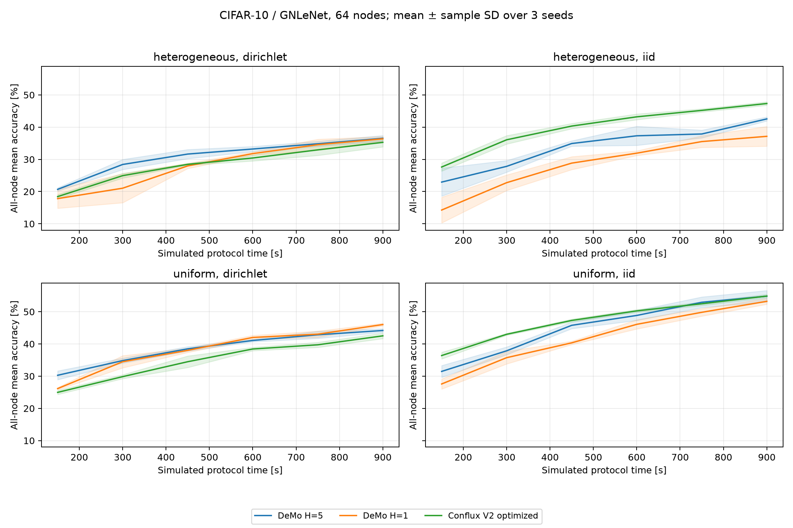
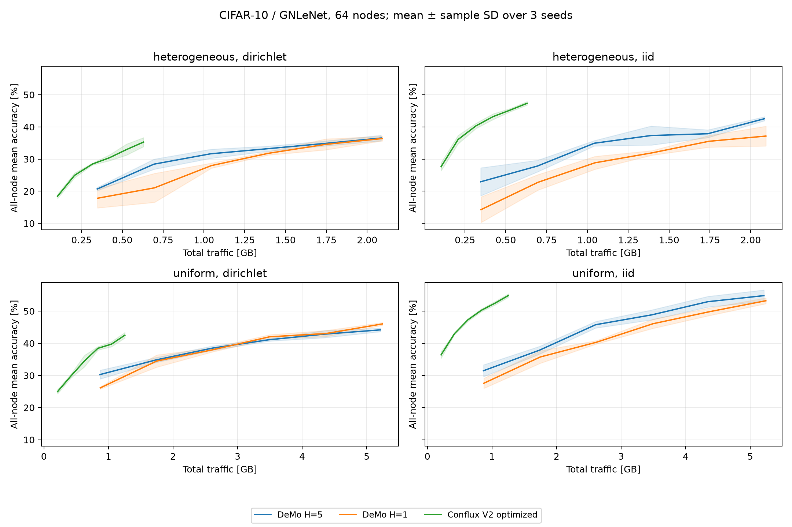
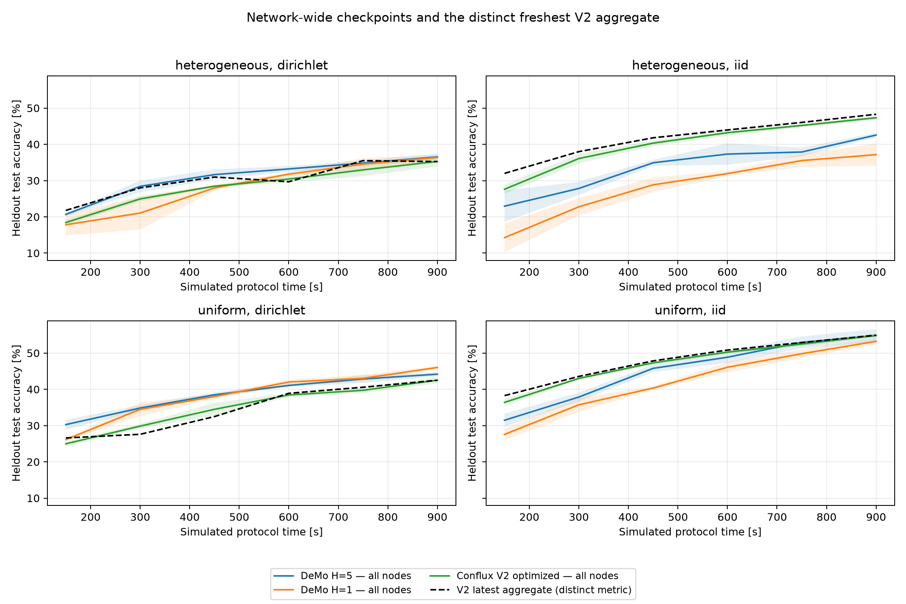

# DeMo baseline

DeMo (Decoupled Momentum Optimization, ICLR 2026) is implemented as a stable-membership, synchronous sparse collective. Primary sources: [conference paper](https://proceedings.iclr.cc/paper_files/paper/2026/hash/17790fc9b4828206f99a0dea35da3657-Abstract-Conference.html), [paper v2](https://arxiv.org/html/2411.19870v2), and [official standalone optimizer](https://github.com/bloc97/DeMo/blob/0e48145d702b25f83055e11d9585a9c11bcfe154/demo.py) (SHA256 `578068af51d543477d79af06caa6e3c01d544db0967c8d13b6ba2972d209a8ce`).

The implementation follows the released Signum optimizer, including details where the paper's prose/pseudocode differ: `delta = .999 * residual + lr * gradient`; orthonormal block DCT; top-32 coefficients per block with target chunk 64; subtract the worker's own decoded transmission; gather sparse indices and values; average collisions among **transmitted** values (`scatter_reduce(mean, include_self=False)`); inverse transform; decoupled weight decay and `parameter -= lr * sign(reconstruction)`. Missing coefficients are not treated as extra zero-valued participants in that mean. Residuals remain private to each worker and persist as immutable DAG outputs across rounds. Ordinary local SGD momentum is rejected.

The reference transform handles vectors and matrices. Convolution kernels are unfolded into `(out_channels, -1)` matrices, then restored after inverse transformation. This explicit CNN adaptation is not a reproduction of the paper's language-model experiments. Models with buffers (including BatchNorm running statistics) or frozen parameters are currently rejected instead of silently dropping their state. CPU and CUDA share the same Torch implementation; deterministic CPU coefficient accumulation avoids CUDA scatter atomic ordering differences. No new runtime dependency is needed.

A decentralized ring all-gather forwards each worker's packet over `N-1` hops. Every transfer charges int64 indices and parameter-dtype values, metadata, latency, and bandwidth contention. GNLeNet has 85,354 parameters and its default packet is 20,472 bytes (the comparison's pinned full-model payload remains 346,251 bytes). No dense model broadcast is added after the collective: all recipients compute identical updates. The local executor memoizes that identical pure update, but each node publishes it only after its own complete gather. Workers can enter their next logical iteration at different physical times; future packets are buffered. Stable membership is required; churn recovery is not implemented. As for the other baselines, compression/aggregation compute has zero simulated duration; real execution time is measured separately.

`--algorithm demo` and `scripts/run_cifar.py --variants demo` expose `--demo-decay`, `--demo-chunk`, `--demo-topk`. `learning.local_steps` is the number of microbatch gradients accumulated at **fixed** parameters before a DeMo optimizer step. Thus H=1 is the canonical one-batch algorithm; H=5 matches the other algorithms' five-batch compute block but does not mean five uncommunicated sign updates. Mean microbatch gradients are used. Batch size and simulated per-microbatch compute cost retain their existing meanings. GPU residency/batching optimizations for ordinary SGD tasks do not apply to these custom tasks; this affects execution speed only.

`tests/test_demo.py` checks independent SciPy DCT values, collision means, residual conservation/persistence, the dense SignSGD limit, fixed-weight gradient accumulation, exact wire-byte accounting, single-node and multi-node ring causality, skewed arrivals, and retained/streaming execution equivalence. `tests/check_demo_reference.py PATH_TO_OFFICIAL_DEMO_PY` additionally runs seven steps with three workers against the pinned official optimizer: zero parameter difference and maximum residual difference `4.19e-9` on CPU.

The CIFAR evaluation driver is `scripts/benchmark_demo.py`. Before test evaluation it selects an LR independently for H=1 and H=5 from `[0.0003, 0.001, 0.003, 0.01]`, maximizing mean uniform IID/Dirichlet validation accuracy at 900 simulated seconds, seed 0 (lower LR breaks ties). Both configurations then run the fixed 64-node matrix: uniform/heterogeneous capacities, IID/Dirichlet alpha 0.1, seeds 0/1/2, 900 simulated seconds and 150-second snapshots, full 10,000-image test set. The validation split contains 5,000 separate images. Conflux V2's audited optimized comparison uses sample/chunks/reducers 16 and immediate uploads. Its per-seed cached results are checked using fresh seed-0 IID and Dirichlet replays in each profile. Both protocols are compared using all nodes' stored completed models, with V2's freshest aggregate reported separately.

Execution is frozen at commit `73cba38`, source SHA256 `948e33c642a2dea2732f0c9dbcd84c48235e0efe5018944aedb88799258638d8`, under `/mnt/data/mdevos/conflux/demo-code`. Raw DAGs and per-node outputs stay under `/mnt/data/mdevos/conflux/results/demo64`. The focused comparison regression suite passes 117 tests on Linux/CUDA and 111 on macOS/CPU with six CUDA-only skips. The repository also contains unchanged legacy tests that fail under the current settings API; the full legacy test tree is not claimed to pass.


## CIFAR-10 results

All runs completed on sacs006. The heterogeneous profiles are controlled synthetic capacities, **not FedScale traces**: compute-time multipliers are drawn from `{0.5, 1, 2, 4}` independently of bandwidth assignments and normalized to a mean 20 ms per microbatch; one quarter of nodes have 8× the others’ bandwidth, normalized to a mean 100,000 bytes/s. The uniform profile assigns those means to every node. All algorithms receive the same per-node capacities for each seed. The audit covers 24 new DeMo test runs, 16 separate validation runs, four fresh V2 cache checks and 12 cached V2 runs: 21,504 per-node checkpoint rows, six snapshots and all 64 nodes per run, finite metrics and conserved bytes. All four V2 reruns match every cached per-node metric, client statistic and traffic snapshot exactly. Only DeMo functions were appended to the shared execution module; prior V2 protocol, training and executor files are unchanged. A broker settings registration was added after the execution freeze and tested separately; the frozen benchmark source was preserved.

Validation selected LR **0.003 for H=1**, **0.001 for H=5**, with decay/chunk/top-k fixed to the released defaults. Both configurations are reported without selecting between them on the test set. V2 retains its previous LR 0.01 and five local SGD steps. These are comparisons of complete optimizers/protocols, rather than a controlled compression-only ablation.

Final full-test accuracy (%) is the mean across all nodes' stored completed models at **900 simulated seconds**, then mean ± sample SD across three seeds:

| Network | Data | Conflux V2 optimized | DeMo H=1 | DeMo H=5 |
|---|---|---:|---:|---:|
| uniform | IID | 54.86 ± 0.54 | 53.24 ± 0.90 | 54.83 ± 1.77 |
| uniform | Dirichlet α=0.1 | 42.52 ± 0.86 | 46.03 ± 0.42 | 44.18 ± 0.55 |
| heterogeneous | IID | 47.33 ± 0.55 | 37.15 ± 3.06 | 42.56 ± 0.62 |
| heterogeneous | Dirichlet α=0.1 | 35.28 ± 1.40 | 36.38 ± 0.71 | 36.54 ± 0.87 |



V2 remains ahead on heterogeneous IID data: +4.78 points versus H=5 and +10.18 versus H=1. Uniform IID accuracy is nearly tied with H=5 (54.86% versus 54.83%); H=1 finishes 1.63 points below V2. On uniform non-IID data, H=1 improves accuracy by 3.51 points and H=5 by 1.66. On heterogeneous non-IID data, the mean improvements are 1.10 and 1.26 points respectively. The H=1 non-IID improvement is positive in all six paired seeds; the H=5 heterogeneous non-IID improvement occurs in two of three seeds. These three-seed results are screening evidence, not a universal ranking or statistical-significance claim. Heterogeneous non-IID cross-entropy is slightly lower for V2 despite DeMo's higher accuracy (1.747 versus 1.765/1.776), so DeMo does not dominate every quality metric.

Mean aggregate traffic over the same horizon (decimal GB; equal for IID/non-IID within each protocol/profile):

| Network | Conflux V2 | DeMo H=1 | DeMo H=5 |
|---|---:|---:|---:|
| uniform | 1.253 | 5.242 | 5.213 |
| heterogeneous | 0.630 | 2.093 | 2.085 |

DeMo therefore sends 4.16–4.18× as many bytes in the uniform network and 3.31–3.32× in the heterogeneous network. V2 uses about 76% and 70% fewer bytes respectively. Each DeMo worker receives every other worker's sparse message, about 1.29 MB per completed update before headers, despite its 20 KB individual packet. V2's sampled aggregation has a different communication pattern and remains more communication-efficient at the observed common accuracy targets.



Time to accuracy uses the first observed 150-second checkpoint; values below are per-seed times in seed order 0/1/2, without interpolation:

| Setting / target | Conflux V2 | DeMo H=1 | DeMo H=5 |
|---|---|---|---|
| Uniform IID, 40% | 300/300/300 s | 450/450/600 s | 450/450/450 s |
| Uniform non-IID, 40% | 750/900/900 s | 600/600/600 s | 600/600/600 s |
| Heterogeneous IID, 40% | 600/450/450 s | unreached in all seeds | 900/900/900 s |
| Heterogeneous non-IID, 30% | 600/600/750 s | 600/600/600 s | 300/450/450 s |

Unreached targets are right-censored at 900 seconds, including 40% on heterogeneous non-IID data for every protocol. Faster non-IID convergence is a useful DeMo result, with substantially more traffic. At the heterogeneous non-IID 30% target, H=5 uses 0.695–1.042 GB versus V2's 0.412–0.518 GB; see the exact per-seed checkpoint counts in `time-to-accuracy.csv`.

The comparison includes different compute use: V2 schedules about 9,198 microbatches in uniform and 4,620 in heterogeneous networks; DeMo H=1 schedules 4,096/1,664 and H=5 schedules 20,160/8,320. H=5's higher work count does not produce a broad win over V2. Actual simulator execution time on the GPU machine is separate: mean per-run execution is 30–31 s (H=1) and 54–55 s (H=5) in uniform networks, 14 s and 23 s in heterogeneous networks. Cached V2 timings are roughly 27 s/16 s from previous jobs. These timings include model training/evaluation and simulator execution, and do not establish protocol speed or a controlled executor benchmark.

## Aggregate freshness

At 900 seconds all DeMo nodes hold its latest completed collective output: round 63 for H=1 and 62 for H=5 in uniform networks, round 25 in heterogeneous networks. V2's latest completed sample aggregate is a separate readout, and gives mean accuracy 54.93%/42.51% for uniform IID/non-IID and 48.29%/35.24% for heterogeneous IID/non-IID. Its all-node stored-model means are the values in the primary table. Mean V2 node age is 2.82 rounds in uniform networks and 3.24 in heterogeneous networks; per-seed maxima and all checkpoints are retained in `latest-aggregate.csv`. Age does not imply selected V2 trainers use stale inputs: they receive the current sample input before training.



Compact data, manifests, audits, source provenance, validation scores, per-seed time-to-accuracy and PNG/SVG plots are in [`output/demo64`](../../output/demo64). Raw workflow DAGs, per-node metrics and client/network statistics remain on the server. Compression parameters were not tuned, and the LR search used one uniform seed on the separate validation split; broader tuning, longer horizons and further datasets could change the ranking. No churn recovery was evaluated.


For a fresh reproduction (use a new output directory):

```sh
python scripts/benchmark_demo.py --output output/demo64-new \
  --dataset-base-path /path/to/cifar-cache --mode tune --device cuda:0
python scripts/benchmark_demo.py --output output/demo64-new \
  --dataset-base-path /path/to/cifar-cache --mode evaluate --profile uniform --device cuda:0
python scripts/benchmark_demo.py --output output/demo64-new \
  --dataset-base-path /path/to/cifar-cache --mode evaluate --profile heterogeneous --device cuda:1
```

The two evaluation profiles can run concurrently on separate GPUs after tuning. The archived `output/demo64/run.py` records how the server distributed the two tuning sweeps across its GPUs. `report.py` records the exact audit and figure generation used for this study. The later broker registration has its own passing configuration check on both platforms (`broker-check.txt` on Linux); it does not change protocol or optimizer arithmetic.
