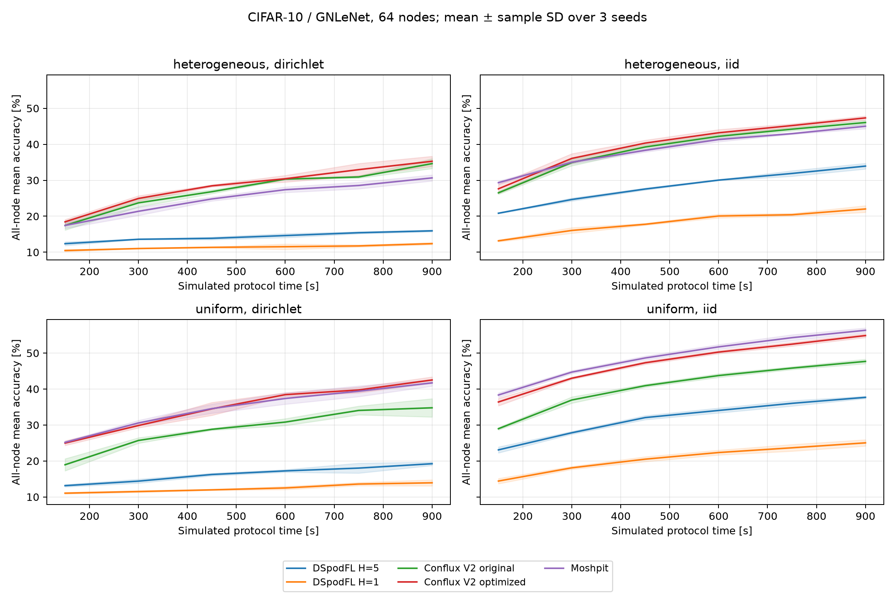

# DSpodFL comparison

This implements [DSpodFL, ICLR 2025](https://proceedings.iclr.cc/paper_files/paper/2025/hash/9521b6e7f33e039e7d92e23f5e37bbf4-Abstract-Conference.html)
from [Equation (2) and Algorithm 1](https://arxiv.org/html/2402.03448#A2), checked
against the authors' [reference agent](https://github.com/ShahryarBQ/DSpodFL/blob/main/src/Agent.py).
The CIFAR comparison uses the same simulator, model, dataset split, capacity
assignments and network accounting as Conflux V2. It is a framework implementation
under our workload, rather than a reproduction of the paper's VGG11/RGG experiment.

## Completed results

All 24 new DSpodFL runs completed on `sacs006`. Original/optimized V2 and Moshpit
are the 36 unchanged, previously audited comparison runs. Accuracy after 900
simulated seconds is the mean of all 64 nodes' stored completed models, averaged
over three paired seeds; ± values are sample standard deviations across seeds.

| Method | Uniform IID | Uniform Dirichlet | Heterogeneous IID | Heterogeneous Dirichlet |
| --- | ---: | ---: | ---: | ---: |
| Conflux V2 optimized | 54.86 ± 0.54 | 42.52 ± 0.86 | 47.33 ± 0.55 | 35.28 ± 1.40 |
| Conflux V2 original | 47.68 ± 0.62 | 34.78 ± 2.55 | 46.05 ± 0.59 | 34.63 ± 1.37 |
| DSpodFL H=5, local-SGD extension | 37.69 ± 0.33 | 19.23 ± 0.48 | 33.93 ± 0.79 | 15.94 ± 0.26 |
| DSpodFL H=1, paper update | 25.04 ± 0.88 | 13.93 ± 0.85 | 22.02 ± 0.93 | 12.38 ± 0.29 |
| Moshpit, one phase | 56.33 ± 0.67 | 41.71 ± 0.90 | 45.02 ± 0.68 | 30.66 ± 0.84 |

Optimized V2 has higher final accuracy in every paired DSpodFL comparison.
It also uses fewer bytes at the fixed endpoint:

| Method | Uniform traffic, GB | Heterogeneous traffic, GB |
| --- | ---: | ---: |
| Conflux V2 optimized | 1.253 | 0.630 |
| Conflux V2 original | 0.654 | 0.565 |
| DSpodFL H=5 | 3.279 | 1.103 |
| DSpodFL H=1 | 3.286 | 1.121 |
| Moshpit | 5.226 | 1.761 |

Traffic uses decimal GB and includes metadata and unfinished transfers. It is
identical between data partitioners at a given profile/seed because protocol
scheduling is independent of model accuracy. Compared with DSpodFL H=5, optimized
V2 sends 61.8% fewer bytes in the uniform profile and 42.9% fewer in the heterogeneous
profile. This comparison uses common endpoint budgets, rather than equal traffic.

For uniform IID data, optimized V2 first reaches 40% at 300 seconds in every seed;
neither DSpodFL configuration reaches 40% within 900 seconds. For heterogeneous
IID data, optimized V2 first reaches 30% at 300 seconds in every seed, while
DSpodFL H=5 reaches it at 600, 750 and 750 seconds. Both DSpodFL configurations
remain censored at 30% for both non-IID profiles; optimized V2 reaches that target
in all seeds. These are observations at fixed 150-second checkpoints.

The H=5 difference is not explained by V2 doing more SGD work. DSpodFL schedules
about 11,977 SGD steps versus V2's 9,198 in the uniform profile, and 8,437 versus
4,620 in the heterogeneous profile. Sparse old-model mixing and our probability
policy are plausible contributors to lower learning progress per communicated
byte, but this comparison does not isolate a causal bottleneck. H=1 uses fewer
SGD steps and is included to distinguish the faithful one-step rule from the block
extension. The topology and activation policy are fixed and have not been tuned
on the validation split. The results therefore do not establish that DSpodFL
underperforms across its broader family of configurations.



See [loss](../../output/dspodfl64/loss.png),
[accuracy versus traffic](../../output/dspodfl64/traffic-accuracy.png),
[numeric results](../../output/dspodfl64/comparison.csv),
[time to accuracy and censoring](../../output/dspodfl64/time-to-accuracy.csv),
[paired differences](../../output/dspodfl64/paired-v2.csv),
[execution plan](../../output/dspodfl64/plan.json), and
[audit](../../output/dspodfl64/audit.json).
All 360 aggregate checkpoint rows and 23,040 per-node rows pass coverage/finite-metric
and byte-conservation checks; 9,216 per-node rows belong to the 24 new runs.
Dataset provenance, runtime versions and per-node capacities match the cached runs.

## Update semantics

For each logical iteration, both endpoints of a physical edge use the same seeded
Bernoulli draw. Active edges exchange **old** models from that iteration. Each
node independently chooses whether to perform a local SGD update. Its result is:

```text
next_model_i = local_trained_model_i
             + Σ_j r_ij × (old_model_j − old_model_i)
```

If local training is skipped, `local_trained_model_i = old_model_i`.
`r_ij = 1 / (1 + max(degree_i, degree_j))` uses degrees of the physical graph.
Inactive weights return to the diagonal; surviving edges are not renormalized.
The induced mixing matrix is symmetric, nonnegative and doubly stochastic.
This differs from averaging the newly trained neighbor models, which would
incorrectly dilute/mix the local gradient in Equation (2).

With `--local-steps 1`, this is the paper's one-step SGD equation. With
`--local-steps 5`, the local update is a five-step local-SGD delta, matching the
previous comparison's local block length. That is an explicit extension, rather
than a claim that the paper analyzes five-step deltas as one stochastic gradient.
Both configurations are reported separately.

Old-model transfers overlap computation. A node waits for its own selected
training and all active same-iteration neighbors before publishing its update.
Arrivals before local startup/training completion and future-iteration arrivals
are buffered separately. Data dependencies enforce causality without an extra
global iteration barrier. Empty iterations have a minimum 20 ms opportunity
duration, preventing infinitely many free iterations; this is an explicit
simulation convention, not an inferred computation cost from the paper.
Control headers and full model transfers consume the shared bandwidth/latency
scheduler. Local training has the existing explicit simulated duration; aggregation
is instantaneous in simulated time for every method.

## Predeclared policy

The main comparison uses a seeded connected degree-4 random regular graph.
This is a valid physical topology for the framework, and differs from the
paper's random geometric graph. Nominal SGD and link probabilities are both 0.5.
They are reduced for below-average capacity:

```text
p_sgd(i)  = 0.5 × min(1, mean_training_duration / training_duration_i)
p_link(ij)= 0.5 × min(1, min(bandwidth_i, bandwidth_j) / mean_bandwidth)
```

The policy is independent of client data, accuracy and test results. Capacities,
topology, mixing weights and probabilities are fixed; event masks change each
iteration. Probabilities and edges are saved in `dspodfl_probabilities.csv`.
`constant` and `beta` probability modes are also implemented; `beta` draws fixed
node/edge probabilities from Beta(0.8, 0.8), as in the paper's CIFAR experiment.
They are not part of this fixed matrix, and the capacity-derived policy is not
claimed to be an author-tuned default.

Stable membership and plain SGD are required. Sporadic computation/communication
does not implement offline-node failure detection, reconnects or recovery.
Nonzero momentum and weight decay are explicitly rejected for this implementation.

## Evaluation

The matrix uses CIFAR-10/GNLeNet, native 32×32 inputs without augmentation,
64 nodes, seeds 0–2, uniform/heterogeneous capacities, IID/Dirichlet α=0.1 data,
900 simulated seconds and snapshots every 150 seconds. Learning rate is 0.01,
batch size 32, momentum/weight decay zero. Bandwidth is 100,000 bytes/s on average
with the previous quarter-fast 8× spread and independently assigned compute
ranking; nominal SGD step time is 20 ms and one-way latency is 20 ms. The common
model payload is 346,251 bytes. All checkpoint metrics use the full 10,000-image
test split; the 45,000/5,000 training/tuning split is unchanged.

Twenty-four new DSpodFL runs cover both H=5 and H=1. Original/optimized Conflux V2
and Moshpit use 36 cached, audited runs from `output/v2-uploads64`. All 103 existing
`dasklearn` execution files except the baseline registration module are byte-identical
to that frozen source; registration only adds DSpodFL. Cache provenance is retained,
and capacities, learning/evaluation settings, node coverage and byte accounting
are checked again. Cached execution timings remain from the previous experiment
and are separate from simulated protocol performance.

The primary metric is the mean of all physical nodes' stored completed models at
fixed simulated times. DSpodFL has distinct local models and no shared aggregate.
V2's latest sample aggregate and node staleness are reported separately and do not
replace the network-wide metric. Accuracy targets use first observed checkpoints;
unreached targets are explicitly censored. All configurations are reported without
heldout-test selection. Three seeds and common, untuned learning settings provide
screening evidence, not a universal algorithm ranking.

The focused suite passes 104 tests on Linux/CUDA and 98 on macOS/CPU, with six
CUDA checks skipped. New checks cover the one-step equation and block extension,
old-model provenance, symmetric masks, Metropolis weights, no-SGD/no-link limits,
causal updates under compute skew, byte conservation and reproducibility.

Execution source: commit `a71720f`, SHA256
`f3d42e5a990a7014745dc4355aad8925bb77fe7cd6959883441b4ab903d3d33a`.
Server code is frozen at `/mnt/data/mdevos/conflux/dspodfl-code`; results and raw
DAGs/per-node files are under `/mnt/data/mdevos/conflux/results/dspodfl64`.

```sh
python scripts/benchmark_dspodfl.py --output output/dspodfl64 \
  --dataset-base-path /path/to/cifar-cache --profile uniform --device cuda:0
python scripts/benchmark_dspodfl.py --output output/dspodfl64 \
  --dataset-base-path /path/to/cifar-cache --profile heterogeneous --device cuda:1
```

The profiles can run concurrently on separate GPUs or sequentially on one GPU.
The general simulator and comparison runners also accept `--algorithm dspodfl`
and `--variants dspodfl`, respectively. Policy flags are `--dspod-degree`,
`--dspod-sgd-probability`, `--dspod-communication-probability`, and
`--dspod-probability-mode`.
