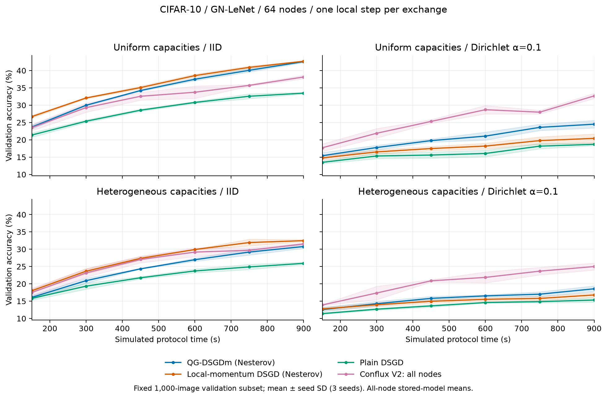
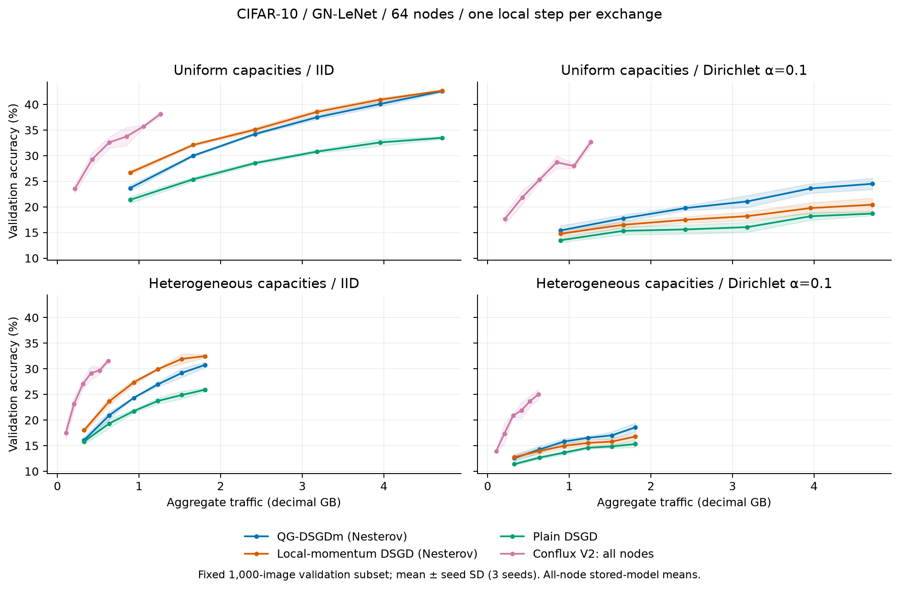
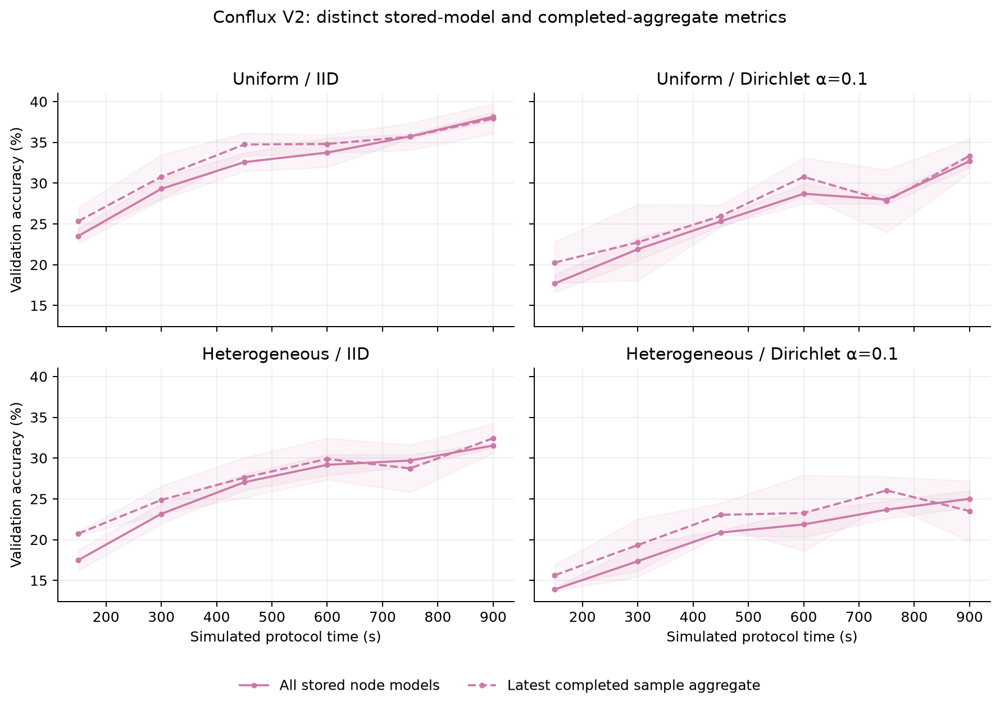

# QG momentum and Conflux V2: CIFAR-10, 64 nodes

QG momentum improves non-IID accuracy over ordinary persistent local momentum,
but does not close the gap to Conflux V2 in this benchmark. Under uniform IID
conditions, both momentum baselines achieve higher accuracy than V2 while
using substantially more communication and gradient steps. Under heterogeneous
IID conditions, local momentum leads and QG momentum trails both local momentum
and V2. These are three-seed screening results, not a universal ranking.

## Implementation and checks

The baseline implements [QG-DSGDm, ICML 2021](https://proceedings.mlr.press/v139/lin21c.html).
It uses one gradient step per exchange, symmetric Metropolis mixing, and a
private momentum buffer updated from the displacement after mixing. The matched
local-momentum control retains the ordinary local gradient momentum instead;
plain DSGD disables momentum. The buffer persists as an immutable DAG output,
including across workers/replay, and is never transmitted. All three controls
send the same dense parameter packets. Nesterov is enabled for the comparison.
See [implementation contract and baseline-only evidence](../qgm.md).

The actual numerical optimizer step from the pinned official implementation
matches our eight-round/four-worker reference check to `2.22e-16`, including
ordinary/Nesterov modes and weight decay. Main passed 227 CPU tests with 13 CUDA
skips; the common research snapshot passed all 265 tests on Linux CUDA. Real
broker replay matched 48 validation rows and eight full-test rows through both
one-broker/two-worker and two-broker/one-worker layouts.

## Design and provenance

All 48 evaluation jobs are fresh runs from common frozen execution source
`0334052`, SHA256
`f8cb89129d345e21e6823d2e7f8f1b8328e4e074f9bfff50e0866acaea72332a`.
The digest concatenates sorted `dasklearn/**/*.py` and `scripts/*.py` relative
path bytes and file bytes. This is a new **H=1** comparison, including fresh V2;
older H=5 V2 results were not reused.

- CIFAR-10, GN-LeNet, 64 nodes, seeds 0/1/2, no augmentation, batch 32, zero
  weight decay, one gradient step per exchange, 900 simulated seconds.
- Disjoint 45000 training / 5000 validation / 10000 test examples. IID or
  Dirichlet alpha .1. Six snapshots use a fixed balanced 1000-image validation
  subset; final evaluation uses all 10000 test images for every node.
- Uniform capacities or independent network/compute heterogeneity with matched
  means of 100000 B/s and 20 ms per gradient step, with 20 ms network latency.
  One quarter of nodes have 8× the raw bandwidth of the others; compute factors
  are independently sampled from .5/1/2/4. Both are normalized to matched means.
  These are synthetic capacities, not FedScale traces. Stable membership only.
- The momentum controls use a fixed two-neighbor ring, Metropolis weights,
  beta=mu=.9, and Nesterov. Each transfer carries 341416 parameter bytes plus
  charged control/metadata overhead; no private momentum is sent.
- V2 uses sample/chunks/reducer limit 16/16/16, immediate uploads, all sample
  members contributing, world-wide reducer placement, no local momentum, and
  the comparison's pinned 346251-byte full-model payload. Its topology differs
  from the fixed ring; this is a protocol comparison under common capacities.
- Each method selected LR from .001/.003/.01/.03/.1 using mean final **full
  validation** accuracy across uniform IID/non-IID seed-0 runs. Selection was
  fixed before test evaluation. QG/local momentum selected .003; plain DSGD
  and V2 selected .01. No heterogeneous/test-based retuning was done.

All 40 tuning jobs and 2560 per-node validation rows passed before selection;
none contained held-out test tasks. All 48 evaluation jobs passed, with 18432
validation-node rows and 3072 final full-test-node rows audited. Every snapshot
contains all 64 nodes, finite metrics and valid round IDs. Initial round-0
models at early V2 checkpoints are retained and their metrics agree. Shared
capacities match exactly; traffic counters balance; all three momentum controls
have exactly identical traffic/work within a profile/seed. Data partition does
not change any protocol's schedule within a profile/seed.

Execution used sacs006, two RTX 5000 Ada GPUs, Conda Python 3.12.15 and Torch
2.14.1+cu130. Code remains frozen at
`/mnt/data/mdevos/conflux/qgm-evaluation-code`; raw DAGs and all per-node files
remain at `/mnt/data/mdevos/conflux/results/qgm64`. Dataset archive SHA256 is
`fc1326d1e265748b913f171956c2ce209cf5812729b532935f2e5cd4752c9be1`.

## Accuracy and loss

Final **full-test accuracy (%)**, mean of all nodes' stored models, then mean ±
sample SD across three seeds. No global parameter average is constructed.

| Capacities | Data | Plain DSGD | Local momentum | QG momentum | Conflux V2 |
|---|---|---:|---:|---:|---:|
| Uniform | IID | 35.27 ± 0.17 | 44.10 ± 0.50 | 44.24 ± 0.21 | 39.69 ± 0.60 |
| Uniform | Dirichlet α=.1 | 19.29 ± 0.43 | 20.86 ± 1.21 | 25.23 ± 1.09 | 34.26 ± 1.08 |
| Heterogeneous | IID | 27.45 ± 0.41 | 34.12 ± 0.52 | 32.85 ± 0.41 | 33.41 ± 0.41 |
| Heterogeneous | Dirichlet α=.1 | 15.66 ± 0.67 | 17.13 ± 0.51 | 19.14 ± 1.05 | 26.26 ± 1.34 |

QG improves non-IID accuracy over local momentum by 4.37/2.01 percentage points
for uniform/heterogeneous capacities. It also reduces non-IID cross-entropy to
2.577/2.853, versus 3.310/3.497 for local momentum and 2.919/3.086 for plain
DSGD. V2 is better on both non-IID accuracy and cross-entropy (1.786/2.001).
Uniform IID loss favors QG (1.540 versus V2's 1.696); heterogeneous IID loss
favors local momentum (1.824, versus V2 1.845 and QG 1.855).

The following curves are **1000-image validation accuracy**, distinct from the
full-test table above. Shading is seed SD, not a confidence interval.



## Traffic, work and time to accuracy

Mean aggregate traffic and scheduled gradient tasks at 900 seconds:

| Capacities | Traffic, each momentum control | V2 traffic | Gradients, each control | V2 gradients |
|---|---:|---:|---:|---:|
| Uniform | 4.713 GB | 1.264 GB | 6937 | 1856 |
| Heterogeneous | 1.809 GB | 0.620 GB | 2678.67 | 913.33 |

GB is decimal; counters include in-flight bytes at the checkpoint. Values are
equal for IID/non-IID within each protocol/profile/seed. V2 sends 73.2%/65.7%
fewer bytes than the momentum controls over the horizon. This is not an
equal-work experiment: the same time/capacity budget permits different numbers
of gradient steps. QG's non-IID improvement over its controls uses **exactly**
the same traffic and work as those controls.



Time to accuracy is the **first observed validation checkpoint**, with no
interpolation. Entries are seed 0/1/2 times in simulated seconds; `>900` means
right-censored, not reached. Every higher target is retained in the CSV files.

| Setting / target | Plain DSGD | Local momentum | QG momentum | V2 |
|---|---|---|---|---|
| Uniform IID / 30% | 600/600/600 | 300/300/300 | 450/450/300 | 450/300/450 |
| Uniform IID / 40% | >900/>900/>900 | 750/750/750 | 900/750/750 | >900/>900/>900 |
| Uniform non-IID / 30% | >900/>900/>900 | >900/>900/>900 | >900/>900/>900 | 900/900/600 |
| Heterogeneous IID / 30% | >900/>900/>900 | 600/750/750 | 900/900/900 | 900/600/900 |
| Heterogeneous non-IID / 30% | >900/>900/>900 | >900/>900/>900 | >900/>900/>900 | >900/>900/>900 |

At uniform IID 30%, QG uses 2.422/2.422/1.662 GB versus V2's
.626/.426/.637 GB. At heterogeneous IID 30%, QG uses 1.854/1.764/1.810 GB
versus V2's .624/.418/.609 GB. V2's lower traffic at these common targets
coexists with momentum's advantage at the uniform IID 40% target, which V2
does not reach on the validation curve in this horizon. No ranking is assigned
at a target that a method never reaches.

Real execution time is separate: per-run means are approximately 58–61 seconds
for the three controls and 13 seconds for V2 under uniform capacities; 27–29
seconds versus 7.3 seconds under heterogeneous capacities. Custom gradient tasks
currently take the scalar CUDA path, while V2 uses the existing training
executor optimizations. These timings include training/evaluation and simulator
work and do not establish protocol speed or a controlled executor comparison.

## Aggregate freshness

V2's additional readout selects the **maximum recorded round**, then verifies
that all recipients of that completed sample aggregate have identical metrics.
It does not select a high-performing node. The same check is performed
separately on final full-test evaluations.

| Capacities / data | Latest aggregate full-test accuracy (%) | Mean node age (rounds) | Maximum node age across seeds |
|---|---:|---:|---:|
| Uniform IID | 39.48 ± 2.02 | 2.80 | 15 |
| Uniform non-IID | 34.73 ± 1.34 | 2.80 | 15 |
| Heterogeneous IID | 34.94 ± 1.12 | 3.31 | 25 |
| Heterogeneous non-IID | 24.92 ± 4.58 | 3.31 | 25 |

The latest aggregate can score lower than the stored-model mean, as in the last
row; freshness does not guarantee a better evaluation. The ring baselines hold
different local mixed models, so they have no analogous single shared aggregate.
Both protocols retain the network-wide stored-model metric in the primary
comparison. Early unselected V2 nodes holding their initial round-0 model are
included in both the network mean and staleness calculation.



## Artifacts and reproduction

[Compact audited data and plotting/audit code](../../output/qgm64) include
per-seed summaries, validation curves, final test summaries, traffic, censored
time-to-accuracy, LR selection, provenance and PNG/PDF figures. Raw trained-task
DAGs and per-node files remain on the server. A DAG describes the computation;
it does not itself retain every trained model's weights.

Use a fresh output directory and the common frozen source/environment. Run both
tuning slots (`--slot 0` and `--slot 1`, with separate CUDA_VISIBLE_DEVICES),
wait for completion, select once, then run both evaluation slots:

```sh
python scripts/benchmark_qgm.py --output output/qgm64-new \
  --dataset-base-path /path/to/cifar-cache --phase tune --slot 0 --slots 2 \
  --variants qgm dsgdm dsgd conflux-v2 --nesterov
# Repeat with --slot 1, then wait for both tuning workers.
python scripts/benchmark_qgm.py --output output/qgm64-new \
  --dataset-base-path /path/to/cifar-cache --phase select \
  --variants qgm dsgdm dsgd conflux-v2 --nesterov
python scripts/benchmark_qgm.py --output output/qgm64-new \
  --dataset-base-path /path/to/cifar-cache --phase evaluate --slot 0 --slots 2 \
  --variants qgm dsgdm dsgd conflux-v2 --nesterov
# Repeat evaluation with --slot 1 and wait for both workers.
python output/qgm64/collect.py --input output/qgm64-new --output output/qgm64-new/report
python output/qgm64/plot.py output/qgm64-new/report
```

The LR grid is small and selection used one uniform seed. Three test seeds,
one small architecture, a short horizon, a fixed ring and no churn limit the
conclusions. This does not reproduce the paper's model, epoch schedule,
augmentation or tuned learning-rate recipe. Stronger QG tuning or a different
mixing topology could change the comparison.
