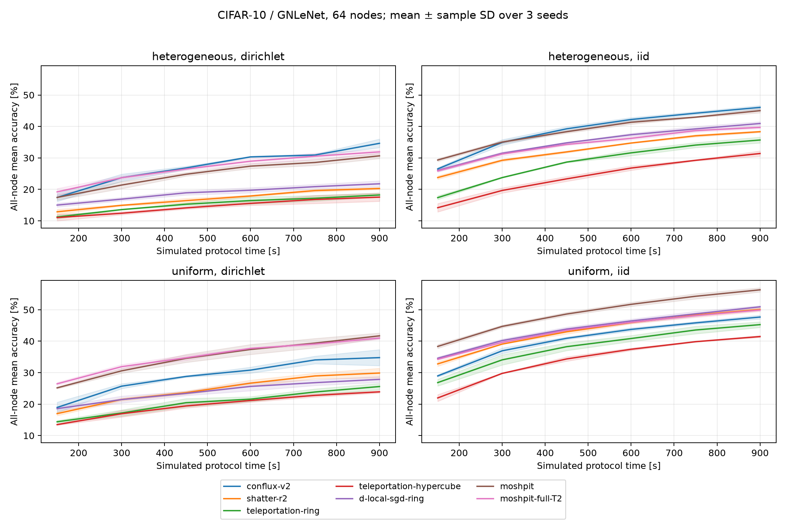
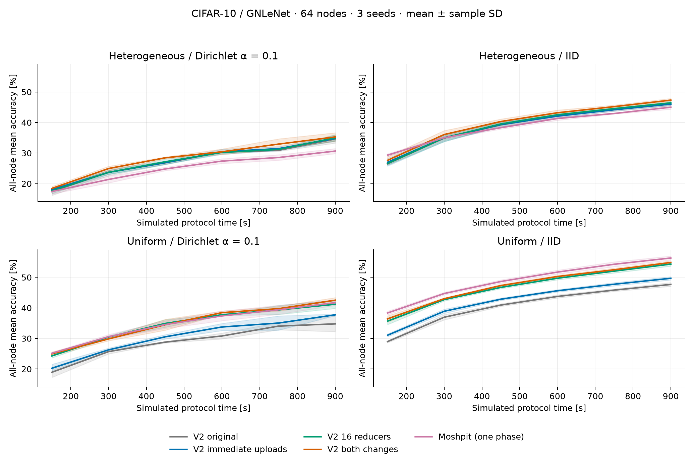

# Literature baselines for Conflux V2

## Completed results

The 84-run CIFAR-10/GNLeNet study on `sacs006` is complete. V2 has the highest
final all-node accuracy in the heterogeneous network; Moshpit has the highest
accuracy in the uniform network. These are conditional results under the common
configuration below, not a claim that either method wins universally.

Accuracy after 900 simulated seconds, mean ± sample standard deviation over
three seeds, evaluated on all 10,000 test images:

| Method | Uniform IID | Uniform Dirichlet | Heterogeneous IID | Heterogeneous Dirichlet |
| --- | ---: | ---: | ---: | ---: |
| Conflux V2 | 47.68 ± 0.62 | 34.78 ± 2.55 | 46.05 ± 0.59 | **34.63 ± 1.37** |
| Shatter degree 2 | 50.10 ± 0.47 | 29.88 ± 1.52 | 38.33 ± 0.28 | 20.27 ± 0.34 |
| Teleportation ring | 45.27 ± 0.89 | 25.59 ± 0.99 | 35.69 ± 0.93 | 18.22 ± 0.62 |
| Teleportation hypercube | 41.48 ± 0.29 | 23.90 ± 0.37 | 31.40 ± 0.83 | 17.53 ± 1.31 |
| D-Local-SGD ring | 50.93 ± 0.37 | 27.87 ± 0.95 | 40.93 ± 0.59 | 21.77 ± 0.96 |
| Moshpit, one phase | **56.33 ± 0.67** | **41.71 ± 0.90** | 45.02 ± 0.68 | 30.66 ± 0.84 |
| Moshpit, two phases | 49.91 ± 0.47 | 40.99 ± 0.43 | 39.70 ± 0.40 | 31.92 ± 0.61 |

In the heterogeneous Dirichlet case, V2 reaches 30% at the 600-second
checkpoint in all three seeds. Two-phase Moshpit first reaches it at 750, 900,
and 750 seconds. One-phase Moshpit reaches it at 900 seconds in two seeds and
is censored in the third; the remaining baselines never reach it in this
budget. All times refer to the all-node mean and fixed-checkpoint resolution.

V2 sends 0.565 GB on average in this case, versus 1.761 GB for one-phase
Moshpit, 1.771 GB for two-phase Moshpit and 1.225 GB for Shatter. Its final
mean loss is 1.776, versus 1.872, 1.906 and 2.371 respectively. Teleportation
sends fewer bytes (0.405–0.420 GB), but reaches substantially lower accuracy.
In the uniform network, one-phase Moshpit's higher accuracy uses 5.226 GB
versus V2's 0.654 GB: about eight times the traffic at the common time budget.
V2 beats each comparator on accuracy in all three paired seeds of both
heterogeneous cases; Moshpit beats V2 in all three seeds of both uniform cases.
Three seeds do not establish a population-level significance claim.

The additional V2 aggregate readout is kept separate. At 900 seconds in the
heterogeneous Dirichlet case, the latest aggregate averages 36.23%, versus
34.63% across stored node checkpoints. Mean node staleness averages 3.66 rounds;
the maximum observed age across these seeds is 21 rounds. Those fresh aggregate
metrics are not substituted into the comparison table.

See the [loss curves](../output/peer-baselines64/with-ablation/loss.png),
[traffic–accuracy curves](../output/peer-baselines64/with-ablation/traffic-accuracy.png),
[numeric comparison](../output/peer-baselines64/with-ablation/comparison.csv),
[paired-seed differences](../output/peer-baselines64/with-ablation/paired-v2-comparison.csv),
[censored time to accuracy](../output/peer-baselines64/with-ablation/time-to-accuracy.csv),
[execution plan](../output/peer-baselines64/plan.json),
[main audit](../output/peer-baselines64/audit.json), and
[ablation/configuration audit](../output/peer-baselines64/with-ablation/audit.json).
All 32,256 per-node checkpoint rows are complete and finite. Actual learning
settings and per-node capacities match across methods. Protocol source is
commit `bd80909`, SHA256
`9be351fee9cdac4fc49816d87665cabfcef722ba0d0c1161cdd2e22513cbe96c`.
Validation passes 80 tests on Linux/CUDA and 74 on macOS/CPU, with six CUDA
checks skipped on the CPU host. Raw DAGs and per-node files remain under
`/mnt/data/mdevos/conflux/results/peer-baselines64`.

## V2 upload scheduling and reducer placement

A fixed follow-up compares the original V2 schedule, immediate uploads, 16
reducers instead of eight, their combination, and one-phase Moshpit. All five
configurations use the same CIFAR/GNLeNet settings above: 64 nodes, 16 sampled
trainers, 900 simulated seconds, both network profiles and data distributions,
and three paired seeds. The four V2 configurations form a 2×2 factorial comparison;
all configurations are reported without choosing hyperparameters on test accuracy.

| Configuration | Uniform IID | Uniform Dirichlet | Heterogeneous IID | Heterogeneous Dirichlet |
| --- | ---: | ---: | ---: | ---: |
| V2 original, 8 reducers | 47.68 ± 0.62 | 34.78 ± 2.55 | 46.05 ± 0.59 | 34.63 ± 1.37 |
| V2 immediate uploads, 8 reducers | 49.69 ± 0.54 | 37.73 ± 0.29 | 46.06 ± 0.49 | 34.79 ± 0.89 |
| V2 original schedule, 16 reducers | 54.34 ± 0.67 | 41.20 ± 1.37 | 46.44 ± 0.65 | 35.00 ± 1.02 |
| V2 immediate uploads, 16 reducers | 54.86 ± 0.54 | **42.52 ± 0.86** | **47.33 ± 0.55** | **35.28 ± 1.40** |
| Moshpit, one phase | **56.33 ± 0.67** | 41.71 ± 0.90 | 45.02 ± 0.68 | 30.66 ± 0.84 |

These are all-node mean accuracies, not the accuracy of a selected aggregate.
The combination improves the uniform non-IID mean by 7.74 percentage points and
the IID mean by 7.19 points. It narrows the IID gap to Moshpit and exceeds its
non-IID mean, but does not beat it in every setting. The heterogeneous improvements
are smaller (1.28 IID points and 0.65 non-IID points); three seeds do not establish
a population-level significance claim.

Broader placement accounts for most of the uniform-network improvement. Immediate
uploads alone help the uniform profile but barely change heterogeneous throughput.
The combined configuration schedules about 90% more local training tasks in the
uniform profile and 11% more in the heterogeneous profile. Those extra updates
consume more bytes at the fixed endpoint: 1.253 GB versus 0.654 GB in the uniform
network, and 0.630 GB versus 0.565 GB in the heterogeneous network. Moshpit uses
5.226 GB and 1.761 GB respectively. Thus the combined V2 still uses about 76% fewer
bytes than Moshpit in the uniform network and 64% fewer in the heterogeneous
network, while spending more than the original V2. Endpoint traffic alone does
not establish better bytes-to-accuracy; first observed targets and censored results
are saved separately.

Time-to-accuracy also shows why this remains opt-in. For uniform non-IID data,
the combination and Moshpit both first reach 40% at 750, 900 and 900 seconds in
the three paired seeds. V2 uses 1.183 GB on average at those checkpoints versus
Moshpit's 4.936 GB; original V2 never reaches 40% within the budget. For
heterogeneous IID data, the combination first reaches 40% at 600, 450 and 450
seconds versus original V2's 600 seconds in every seed. However, for heterogeneous
non-IID data, original V2 first reaches 30% at 600 seconds in all three seeds,
whereas the combination reaches it at 600, 600 and 750 seconds and uses 0.454 GB
on average versus 0.378 GB. Higher final accuracy and more completed rounds do
not guarantee improvements at every observed target. These are fixed 150-second
checkpoint observations, rather than interpolated crossing times.

At the fixed 900-second endpoint, the combined V2's separate latest-aggregate
accuracy averages 54.93% / 42.51% for uniform IID / Dirichlet and 48.29% / 35.24%
for heterogeneous IID / Dirichlet. The all-node metrics in the table also include
older checkpoints. Mean staleness is 2.82 rounds in the uniform profile and 3.24
rounds in the heterogeneous profile; the largest observed ages are 16 and 26
rounds. Latest-round recipients must have identical metrics, even when an aggregate
has only reached some recipients at the time boundary. Moshpit has distinct mixed
local models and is represented by the network-wide metric throughout.

The implementation adds `--immediate-uploads` and `--no-immediate-uploads` to the
simulator and comparison runners. This option is currently opt-in. When success
fraction is exactly one, every reducer already knows the complete contributor set.
Clients upload immediately after training; reducers still wait for all sampled
contributors and average in the original sorted order. Partial-contribution rounds
retain the original ready/plan protocol. Stable membership is still required.
The wider configuration uses the existing placement algorithm with 16 chunks and
`--relay-count 16`, allowing more reducers to carry traffic without changing
sampling or aggregation weights. Main-simulator chunk syntax is
`--chunks-in-sample 16`; comparison runners use `--chunks 16`.

Fixed-round differential tests verify bit-exact models for immediate uploads with
unchanged chunking, numerical equivalence for broader chunking, actual upload/training
overlap, exact partial-round fallback, and byte conservation. The focused suite
passes 91 tests on Linux/CUDA and 85 on macOS/CPU (six CUDA checks skipped).
The completed experiment audit covers all 60 CIFAR runs, 360 aggregate checkpoint
rows and 23,040 per-node rows. All 24 original-V2/Moshpit replays exactly reproduce
the previous study's 9,216 per-node metrics, client statistics and traffic curves.
Every method has identical learning settings and per-node capacity assignments.

The execution code is frozen at commit `e11ac43`, SHA256
`c0281ddd84a9367dffd81239d3aa235f863aaaae1b0aa7ba793d382214a08305`, under
`/mnt/data/mdevos/conflux/v2-uploads-code`. GPU execution time is recorded separately
from simulated protocol time. For example, more learning tasks make the combined
uniform IID run take 26.71 execution seconds on average versus 16.86 for original
V2; this is a protocol-performance optimization, rather than a reduction in the
cost of executing a given training DAG. Chunking and aggregation remain instantaneous
in simulated time for every method.

Results, fixed-checkpoint time to accuracy, paired differences and audits are in
[`output/v2-uploads64`](../output/v2-uploads64). Reproduce both network profiles
with `scripts/benchmark_conflux_v2_uploads.py`; commands are shown in the repository
README. Raw DAGs and per-node measurements remain on `sacs006`.

A supplementary Tiny ImageNet/ResNet18 check uses the previous short-run setup:
128 nodes, sample 32, seed 0, heterogeneous capacities, Dirichlet α = 0.1, 1,800
simulated seconds, five local steps, batch 32, learning rate 0.01 and momentum
0.9. The original uses 16 chunks/reducers; the combined variant uses immediate
uploads and 32 chunks/reducers. Both retain the same learning and capacity settings.

| Tiny ImageNet readout | Original V2 | Both changes |
| --- | ---: | ---: |
| All-node accuracy, final full 10,000 images | 4.5532% | 5.2386% |
| All-node loss, final full 10,000 images | 4.84250 | 4.77835 |
| Latest aggregate accuracy, final full 10,000 images | 4.62% | 5.50% |
| All-node accuracy, fixed 2,000-image curve subset at 1,800 s | 4.7984% | 5.2941% |
| Latest completed aggregate round | 71 | 82 |
| Scheduled local training tasks | 2,304 | 2,656 |
| Traffic at 1,800 s, decimal GB | 204.854 | 236.132 |
| GPU execution seconds | 158.92 | 197.75 |

Latest-round recipients have identical metrics (32 recipients at the final
snapshot). Mean node staleness is 3.0703 / 3.0078 rounds for original / combined;
the maximum is 19 / 30 rounds. The replay exactly matches the previous GPU run's
768 per-node curve rows, 128 final full-validation rows and client statistics.
Both new runs pass node-coverage, finite-metric, shared-capacity and byte-accounting
checks. The 2,000-image curve metric is distinct from the final 10,000-image metric.
This one-seed, early low-accuracy check supports the throughput mechanism; it does
not establish final convergence or performance against Moshpit on Tiny ImageNet.
Compact results and the audit are in
[`output/v2-uploads64/tiny-check`](../output/v2-uploads64/tiny-check).

## Selection

A subsequent [DSpodFL (ICLR 2025) comparison](dspodfl.md) implements and evaluates
sporadic old-model exchange with both one-step and five-step local updates in the
same CIFAR matrix. Its 24 new runs reuse the audited V2/Moshpit comparators.

| Method | Peer-reviewed source | Why compare it |
| --- | --- | --- |
| Moshpit SGD | [NeurIPS 2021](https://papers.neurips.cc/paper_files/paper/2021/hash/97275a23ca44226c9964043c8462be96-Abstract.html) | Small-group chunked all-reduce on heterogeneous devices; the closest collective-communication baseline. |
| Teleportation | [ICLR 2025](https://proceedings.iclr.cc/paper_files/paper/2025/hash/b3732a13897c4cea145c3bdece80de64-Abstract-Conference.html) | Randomly sampled clients inherit logical model tokens, train, and gossip within the active sample. |
| D-Local-SGD | [Unified decentralized/local SGD, ICML 2020](https://proceedings.mlr.press/v119/koloskova20a.html); historical [D-PSGD, NeurIPS 2017](https://papers.neurips.cc/paper_files/paper/2017/hash/f75526659f31040afeb61cb7133e4e6d-Abstract.html) | Full-participation sparse mixing; establishes whether sampling and chunked collectives improve on a basic decentralized reference. |
| Shatter | [PoPETs 2025](https://petsymposium.org/popets/2025/popets-2025-0043.php) | Existing chunked virtual-node baseline, retained in every comparison. |

[AD-PSGD (ICML 2018)](https://proceedings.mlr.press/v80/lian18a.html)
is also relevant to heterogeneous compute, but its concurrent update/communication
semantics need a separate audit. The existing implementation is not certified by
this work. Push-sum methods remain outside the requested scope.

## Implemented protocol contracts

**Moshpit:** algorithms 1 and 2, specialized to stable membership. A seeded
coordinate grid implements rolling group keys by cycling the grouping axis;
members of a group separate in the next dimension. Each group performs an
explicit readiness/plan exchange followed by butterfly reduce-scatter and
all-gather. Chunk ownership stays within the group. Fractions solve the minimax
load-balancing problem in [Appendix G](https://arxiv.org/html/2103.03239#A7),
using symmetric upload/download capacities. A monotone feasibility solver avoids
adding an LP dependency to runtime code; tests independently compare it with
SciPy's LP solver. Integer partitioning preserves every tensor element and byte,
including zero-sized partitions.

The default is one averaging iteration between local-SGD blocks, as in the
paper's ImageNet configuration. `averaging_steps` is configurable; a complete
grid reaches exact consensus after one iteration per dimension. DHT discovery,
failed collectives, recovery and churn are excluded. Membership discovery is an
oracle, consistent with the V2 sampling abstraction. All readiness messages,
model payloads and metadata headers consume the shared network scheduler.

**Teleportation:** [Algorithm 1](https://arxiv.org/html/2501.15259#S3), with
uniform sampling without replacement and random distinct token assignment.
Each token trains on its selected client's data, mixes with same-round trained
neighbor models, and moves to the next token owner through a charged full-model
transfer. Mixing waits for both the local training result and all required
neighbors, even if incoming messages arrive first. Self-handoffs use no network.
The ring and hypercube choices both use symmetric, doubly stochastic mixing
including a self-loop. Hypercube is an additional valid Algorithm 1 topology;
it is not the paper's Base-2 Graph. No claim reproduces the paper's tuning scheme.

The prior Teleportation code used sorted sample IDs as tokens, could mix before
its own training completed, and misindexed next-round state. It was replaced
with an event-driven state machine and mathematical regression tests.

**D-Local-SGD ring:** the same tested mixing engine with fixed tokens, all
clients active and no model handoff between clients. With one local step this
is decentralized SGD in adapt-then-combine form; with the benchmark's five
local steps it is explicitly a local-SGD extension, not a verbatim reproduction
of the 2017 algorithm. It fits Algorithm 1 of Koloskova et al. (ICML 2020),
using identity mixing for the intermediate local updates and a fixed ring
mixing matrix after the fifth update.

All methods use the existing model/data code, bandwidth contention, latency,
training DAG executor and evaluation machinery. Stable membership is required.
As in the existing comparison, chunking and aggregation have zero simulated
compute cost; local SGD has an explicit simulated duration. Measured GPU
execution time does not feed back into protocol time.
The new baselines reject nonzero momentum rather than silently discarding
token-carried optimizer state. The comparison uses plain SGD for every method.

## Benchmark design

The initial screening uses CIFAR-10/GNLeNet, 64 clients, three seeds, uniform and
heterogeneous capacities, and IID and Dirichlet-alpha-0.1 data. Sampled methods
activate 16 clients; V2/Shatter use 8 chunks, Moshpit uses groups of at most 8.
The model payload is pinned at 346,251 bytes for all protocols. Every run uses
the same 900-second simulated budget, snapshots every 150 seconds, five local
SGD steps, batch 32, learning rate .01, zero momentum and weight decay. No
baseline-specific learning-rate or topology tuning uses heldout test data.
The existing native dataset split has 45,000 training, 5,000 tuning and 10,000
heldout test images; all checkpoint metrics use the complete test split.
An additional exploratory 12-run check uses Moshpit with two averaging
iterations per block, giving full-grid consensus on the 8×8 grid. Both
configurations are reported; test results are not used to select one and hide
the other. All 84 runs share the same frozen protocol source. The remaining
uniform seeds were split into independent GPU cohorts; actual per-run learning
settings and capacity assignments are checked against the original matrix.

Primary accuracy/loss is the mean of all physical nodes' stored completed
post-aggregation checkpoints, including stale or initially idle nodes. This
matches the existing V2/Shatter metric, and is not the papers' hypothetical
global parameter average. Teleportation's inactive models are replaced on
reactivation; the stored-node readout therefore also measures dissemination.
V2's latest common aggregate and node staleness are saved separately and must
not be substituted for the network-wide metric when ranking methods.

Traffic includes control messages and unfinished transfer progress. Observing
network checkpoints does not mutate the scheduler or its rounding. Time to
accuracy is the first observed checkpoint reaching a target; unreached targets
remain censored. Simulator/GPU execution time is recorded separately from
simulated learning time. Three seeds and a short common-parameter sweep provide
screening evidence, not a universal ranking or tuned paper reproduction.

Run a sweep with `scripts/run_cifar.py --variants conflux-v2 shatter-r2
teleportation-ring teleportation-hypercube d-local-sgd-ring moshpit`; use
`--group-size` and `--averaging-steps` for Moshpit. The Tiny ImageNet runner also
accepts these variants, with `--momentum 0` required for the new methods.
`scripts/report_baselines.py --root <results>` checks both profile directories,
audits every per-node checkpoint, and produces accuracy, loss, traffic and
censored time-to-accuracy comparisons.
