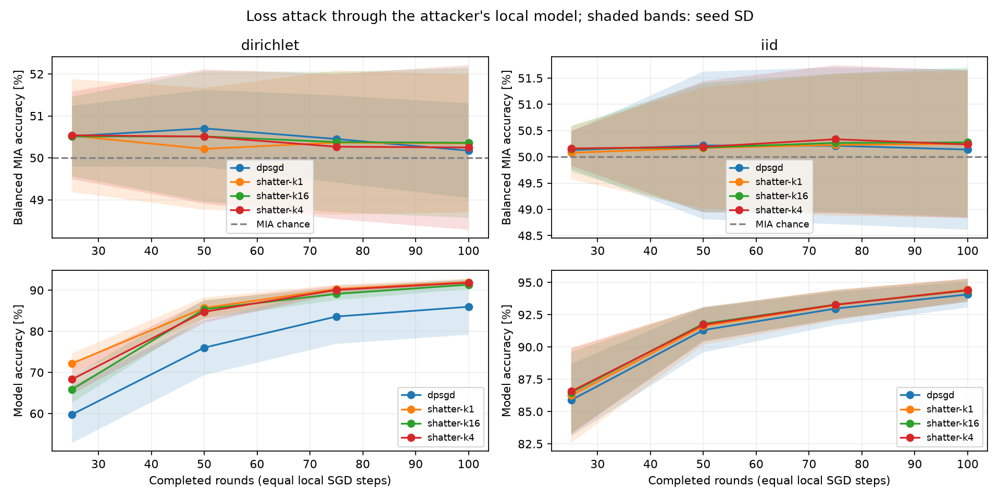

# Initial membership-inference comparison

The loss-based attack showed no clear separation between D-PSGD and Shatter in
this experiment. Balanced attack accuracy at the final checkpoint was close to
50% for all variants. ROC-AUC was slightly above 0.5. These results describe a
weak, single-checkpoint attack through the attacker's own local model; they do
not establish protection against stronger attacks.

## Experiment

- Offline handwritten digits: 1,797 examples, with 1,352 training examples across
  eight disjoint clients and 445 held-out examples.
- Five seeds (0–4), IID and Dirichlet partitions (`alpha=0.3`).
- D-PSGD and Shatter with 1, 4 and 16 chunks. Degree 2 on the respective real-node
  and virtual-node graphs. Shatter-k1 is a changing-topology control.
- Each run: 100 rounds, five local SGD steps per round, batch size 32, learning
  rate 0.1, no momentum or weight decay. This gives 500 optimizer steps per
  client and 4,000 across the eight clients. The two-layer digits MLP and initial
  weights match within each seed.
- Every peer is independently audited as an attacker against each other peer:
  56 pairs per checkpoint, without collusion. Checkpoints: rounds 25, 50, 75, 100.
- The attacker queries its **own post-aggregation local model** with candidate
  examples and known labels. No private victim checkpoint or missing chunk is
  supplied. Membership is assignment to a target training partition.
- Low loss predicts membership. Thresholds use separate class-matched auxiliary
  nonmembers with a 10% empirical calibration FPR budget. Evaluation FPR is
  measured independently. Members, evaluation nonmembers and calibration
  nonmembers have equal class histograms and sizes within each audit.

There are 40 training runs and 8,960 pair/checkpoint measurements. IID cohorts
contain 127–128 examples in each set. Dirichlet cohorts contain 41–117, with
median 90.5, because matching labels trims classes with insufficient held-out
examples. At these sizes, evaluation FPR resolution is about 0.8–2.4 percentage
points, insufficient for claims at very low FPR.

## Final checkpoint: round 100

Values after ± are **sample standard deviations across the five seed means**.
Attack accuracy is balanced accuracy; chance is 50%. Accuracy columns use percent.

| Partition | Protocol | MIA accuracy | ROC-AUC | Model accuracy |
|---|---|---:|---:|---:|
| IID | D-PSGD | 50.14 ± 1.53 | 0.520 ± 0.031 | 94.07 ± 1.00 |
| IID | Shatter, 1 chunk | 50.25 ± 1.40 | 0.522 ± 0.032 | 94.45 ± 0.83 |
| IID | Shatter, 4 chunks | 50.23 ± 1.41 | 0.522 ± 0.031 | 94.40 ± 0.91 |
| IID | Shatter, 16 chunks | 50.28 ± 1.43 | 0.522 ± 0.032 | 94.38 ± 0.88 |
| Dirichlet | D-PSGD | 50.17 ± 1.13 | 0.520 ± 0.029 | 85.96 ± 6.81 |
| Dirichlet | Shatter, 1 chunk | 50.34 ± 1.64 | 0.527 ± 0.035 | 91.96 ± 0.90 |
| Dirichlet | Shatter, 4 chunks | 50.25 ± 1.96 | 0.527 ± 0.035 | 91.81 ± 0.62 |
| Dirichlet | Shatter, 16 chunks | 50.36 ± 1.79 | 0.528 ± 0.034 | 91.34 ± 1.08 |

| Partition | Protocol | Member TPR | Evaluation nonmember FPR |
|---|---|---:|---:|
| IID | D-PSGD | 12.13% | 11.86% |
| IID | Shatter, 4 chunks | 12.01% | 11.54% |
| IID | Shatter, 16 chunks | 12.35% | 11.80% |
| Dirichlet | D-PSGD | 11.93% | 11.58% |
| Dirichlet | Shatter, 4 chunks | 13.30% | 12.81% |
| Dirichlet | Shatter, 16 chunks | 13.21% | 12.50% |

The evaluation FPR differs from the nominal 10% calibration budget, as expected
with independent samples and finite cohorts. Balanced accuracy uses the actual
evaluation FPR, not the nominal budget.

Paired Shatter-minus-D-PSGD differences in balanced attack accuracy are also
small relative to their variation across seeds:

| Partition | Shatter chunks | Difference, percentage points (mean ± SD) |
|---|---:|---:|
| IID | 4 | +0.10 ± 0.31 |
| IID | 16 | +0.14 ± 0.18 |
| Dirichlet | 4 | +0.08 ± 1.04 |
| Dirichlet | 16 | +0.19 ± 0.98 |



## What this supports

This first loss-threshold baseline has little distinguishing power at the
selected operating point on this small workload. Increasing Shatter's chunk
count does not produce a clear reduction in these scores. The slightly
above-chance AUC leaves room for other threshold choices or stronger attacks.
No attack hyperparameters were tuned against the evaluation results.

Shatter's utility is higher under these Dirichlet settings, and the protocols
reach different accuracy levels at equal training budgets. This is not an
equal-utility privacy comparison. D-PSGD uses a fixed topology while Shatter
changes its topology, so the results do not isolate the causal effect of
chunking. The k1 control has similar attack results to the chunked variants.

This common local-model view also omits the received full models available to
D-PSGD neighbors and the partial models available to Shatter neighbors. Measuring
that protocol-specific attack surface requires message observations and an
explicit strategy for using incomplete chunks. Empirical scores here are not
formal privacy guarantees and cannot be transferred to other datasets.

Pairs share models and examples, so uncertainty is summarized across independent
training seeds, not across the 8,960 correlated rows. Five seeds and small
per-class cohorts limit the strength of any comparison.

## Artifacts and reproduction

The exact command was:

```sh
python scripts/compare_membership.py --output output/membership-digits \
  --variants dpsgd shatter-k1 shatter-k4 shatter-k16
```

All remaining settings above are runner defaults. Use a new output directory
when repeating. [manifest.json](manifest.json) records parameters and the source
hash; [environment.json](environment.json) records relevant installed versions.

Machine-readable results: [summary.csv](summary.csv),
[per-seed.csv](per-seed.csv), [attacks.csv](attacks.csv), [runs.csv](runs.csv).
Each ignored `runs/` directory retains the executed DAG, settings, utility
results and individual audit JSON files for local inspection/replay.

Implementation and reuse: [membership inference documentation](../../docs/membership-inference.md).
