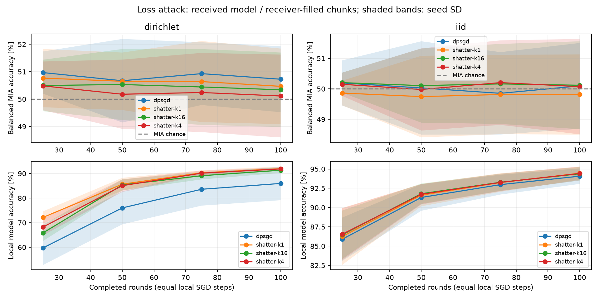

# Incoming-model MIA: class-matched control

**This is a within-class control, not the broader global-nonmember MIA task.**
The low scores below must not be interpreted as general protection against MIA.
The [diagnostics](../membership-diagnostics/REPORT.md) show that changing only the
nonmember distribution raises D-PSGD's non-IID loss MIA AUC from about 53% to 67%.
See the [global-nonmember comparison](../membership-incoming-global-digits/REPORT.md)
for the complementary broader task.

## What was attacked

The observer records actual deliveries before the receiver's protocol callback.
D-PSGD is attacked on the exact received sender model, after its local training
and before aggregation. Shatter is attacked by collecting the unique chunks
received by a physical peer from one sender in one round, and overwriting those
slices in the receiver's latest completed model frozen at the first delivery.
Missing slices never come from the victim. No chunks are combined across rounds
or across receivers. Real sender IDs are visible in the current implementation;
the paper's identity-hiding layer is not modeled.

The experiment uses offline digits, eight peers, five seeds (0–4), IID and
Dirichlet partitions (alpha 0.3), degree 2, 100 rounds, five local SGD steps per
round, batch size 32 and learning rate 0.1. Initialization, data and optimizer
settings match within seeds. Every peer is independently treated as an attacker.
Checkpoints are sender rounds 25, 50, 75 and 100. No collusion is modeled.

Calibration and evaluation nonmembers have the **same label histograms as target
members**. Their held-out pools are disjoint. The loss threshold targets 10%
empirical calibration FPR; evaluation TPR and FPR are measured separately. This
cohort construction removes label-distribution information from the membership
task. It does not remove all sources of within-class distribution differences.

## Final round 100

Mean ± sample SD across five seed means. Balanced attack accuracy and AUC both
have a 50% chance baseline. Values are percentages.

| Partition | Protocol | Balanced attack accuracy | ROC-AUC |
|---|---|---:|---:|
| IID | D-PSGD | 50.10 ± 1.41 | 53.13 ± 3.65 |
| IID | Shatter, 1 chunk | 49.81 ± 1.32 | 52.29 ± 3.24 |
| IID | Shatter, 4 chunks | 50.07 ± 1.56 | 52.12 ± 3.13 |
| IID | Shatter, 16 chunks | 50.12 ± 1.44 | 52.21 ± 3.20 |
| Dirichlet | D-PSGD | 50.73 ± 1.20 | 53.01 ± 3.41 |
| Dirichlet | Shatter, 1 chunk | 50.47 ± 1.38 | 52.65 ± 3.30 |
| Dirichlet | Shatter, 4 chunks | 50.12 ± 1.51 | 52.60 ± 3.31 |
| Dirichlet | Shatter, 16 chunks | 50.34 ± 1.36 | 52.65 ± 3.26 |

## Exposure and conditioning

At round 100, these exposure measurements are the same for both partitioners:

| Protocol | State fraction received per observed pair | Observed pairs out of 56 (mean) |
|---|---:|---:|
| D-PSGD | 100% | 16.0 |
| Shatter, 1 chunk | 100% | 16.0 |
| Shatter, 4 chunks | 35.9% | 37.6 |
| Shatter, 16 chunks | 24.2% | 55.6 |

Scores are conditional on receiving a model or chunk. Pairs without deliveries
are excluded, not assigned chance scores. Shatter spreads fragments to more
physical peers, while each observed pair receives less of the sender's state.
Thus the protocols do not have identical observation populations. Parameter
coverage alone is not a privacy guarantee.

There are 40 training runs and 5,060 observed pair/checkpoint audits. Bytes,
simulated times and all utility CSV values were verified identical to the prior
local-model experiment. Tests additionally check unchanged protocol traces and
complete trained states, immediate/delayed delivery, background freezing,
streaming and saved-DAG replay. All 640 D-PSGD delivery references were checked
to be the correct sender's completed training output for the recorded round.



## Reproduction

```sh
python scripts/compare_membership.py --view incoming \
  --cohort-policy class_matched --output output/membership-incoming-digits \
  --variants dpsgd shatter-k1 shatter-k4 shatter-k16
```

Use a fresh output directory. [manifest.json](manifest.json) records the source
hash and parameters, and [environment.json](environment.json) records versions.
[attacks.csv](attacks.csv), [per-seed.csv](per-seed.csv), [summary.csv](summary.csv)
and [runs.csv](runs.csv) retain the measurements. `runs/` retains executed DAGs,
delivery ledgers and task-specific audit JSON. Pair rows share models and examples;
the reported SD is across seed means rather than treating rows as independent.
