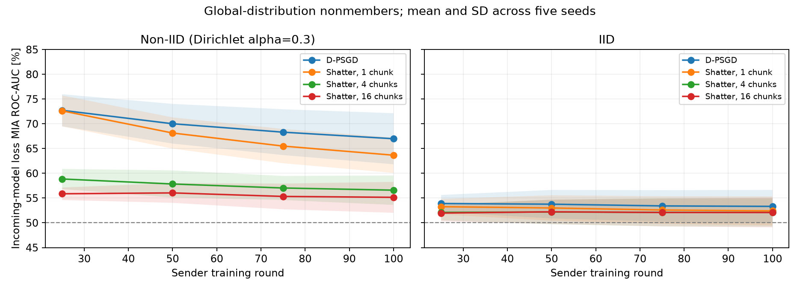

# Incoming-model membership inference with global nonmembers

**D-PSGD exposes a clear membership signal on this non-IID workload.** At round
100, loss-based ROC-AUC is 67.0% for D-PSGD, 56.6% for Shatter with four chunks,
and 55.2% for Shatter with sixteen chunks. These are ROC-AUC scores, not
classification accuracies. On IID digits, all variants remain around 52–53% AUC.

This is the broader global-nonmember task. The complementary
[class-matched control](../membership-incoming-digits/REPORT.md) measures a narrower
within-class task and produces near-chance scores. Changing the nonmember
distribution is consequential and must be stated when interpreting MIA results.

## Experiment and attacker view

- Offline digits; eight peers; five seeds (0–4); IID or Dirichlet alpha 0.3.
- 100 rounds, five SGD steps per peer per round, batch size 32, learning rate
  0.1, zero momentum and weight decay; identical initialization and data per seed.
- D-PSGD degree 2 on a fixed graph; Shatter degree 2 on changing virtual graphs,
  with 1, 4 or 16 chunks. The one-chunk variant is a changing-topology control.
- Each peer is independently an honest-but-curious attacker. No collusion.
- Checkpoints are sender rounds 25, 50, 75 and 100. Only actual completed
  deliveries to that attacker are eligible.
- D-PSGD: score the exact received sender model after local training and before
  aggregation. Shatter: collect unique received chunks from the same sender and
  round, overwrite those slices in the receiver's own model frozen at the first
  delivery, and evaluate after the last delivery. Missing victim chunks are never
  supplied. Sender IDs are visible in this implementation; anonymity is not modeled.

The member example IDs and sample counts match the class-matched control.
Calibration and evaluation nonmembers are instead independently sampled from
the global held-out distribution. Their pools are disjoint across all targets.
This broader task retains label-distribution information under non-IID partitions.
It should not be interpreted as measuring only sample-specific memorization.
Members still inherit the matched control's trimming (41–117 per target under
Dirichlet), so this is not an exact reproduction of another paper's evaluation.

## Final round 100

Mean ± sample SD across five seed means. ROC-AUC and balanced accuracy use a 50%
chance baseline. Balanced accuracy uses a threshold fitted on independent
nonmembers with a 10% empirical calibration FPR budget. Actual evaluation FPR
can differ. All values below are percentages.

| Partition | Protocol | Loss MIA ROC-AUC | Balanced attack accuracy |
|---|---|---:|---:|
| IID | D-PSGD | 53.32 ± 3.32 | 50.07 ± 1.33 |
| IID | Shatter, 1 chunk | 52.42 ± 2.92 | 49.86 ± 1.23 |
| IID | Shatter, 4 chunks | 52.08 ± 2.84 | 50.23 ± 1.43 |
| IID | Shatter, 16 chunks | 52.08 ± 3.00 | 50.09 ± 1.51 |
| Dirichlet | D-PSGD | **66.99 ± 5.16** | **55.84 ± 2.62** |
| Dirichlet | Shatter, 1 chunk | 63.66 ± 3.58 | 55.14 ± 2.50 |
| Dirichlet | Shatter, 4 chunks | **56.60 ± 2.97** | **51.54 ± 1.55** |
| Dirichlet | Shatter, 16 chunks | **55.15 ± 3.13** | **51.04 ± 1.38** |

Non-IID evaluation TPR/FPR at that calibrated operating point:

| Protocol | Member TPR | Nonmember FPR |
|---|---:|---:|
| D-PSGD | 24.33% | 12.65% |
| Shatter, 4 chunks | 16.13% | 13.05% |
| Shatter, 16 chunks | 14.46% | 12.39% |



## Why the initial scores were near chance

The [diagnostic experiment](../membership-diagnostics/REPORT.md) re-scores the
same received D-PSGD models on fixed member examples. Its non-IID AUC is 53.01%
with class-matched nonmembers and 66.99% with global nonmembers. The original
class matching removed much of the label-distribution signal encoded in the
sender's locally trained model. It was insufficient as the sole benchmark for
the broader membership task.

The operating point matters too: for those D-PSGD models, independently calibrating
to 50% FPR gives 62.19% balanced accuracy, compared to 55.84% with a 10% budget.
Both diagnostics are reported; neither is selected using evaluation membership
labels. AUC describes the whole threshold sweep and should not be confused with
accuracy at either threshold.

## Exposure, limitations and checks

At the final checkpoint, mean state received per observed pair is 100% for
D-PSGD and Shatter-k1, 35.9% for Shatter-k4, and 24.2% for Shatter-k16. Mean
observed directed pairs out of 56 are respectively 16.0, 16.0, 37.6 and 55.6.
Pairs without deliveries are omitted, not assigned an artificial chance score.
The protocols therefore have different observation populations.

The lower Shatter scores describe this receiver-state completion strategy. They
are not a privacy guarantee against stronger completion, full message histories,
collusion, active attacks or different workloads. The fixed versus changing
topology and differences in model utility also prevent isolating chunking as
the sole cause. Five training seeds and small target cohorts limit precision.

There are 40 equal-budget training runs and 5,060 pair/checkpoint audits. The
simulated full-model wire size is fixed to 10,994 bytes to pair the runs exactly
with the class-matched control. Every delivery ledger, utility CSV, transmitted
byte count and simulated run time was verified identical between the two cohort
policies. Only the audit candidates change. The independent D-PSGD diagnostic
reproduces the global-cohort AUC. Unit/integration validation passes 293 tests,
with 13 skipped, including complete-state equivalence, temporal observation
boundaries, chunk completion, streaming and saved-DAG replay.

## Reproduction and artifacts

```sh
python scripts/compare_membership.py --view incoming \
  --cohort-policy global_nonmembers --model-bytes 10994 \
  --output output/membership-incoming-global-digits \
  --variants dpsgd shatter-k1 shatter-k4 shatter-k16
```

Use a fresh output directory. [manifest.json](manifest.json) records parameters
and execution-source hash; [environment.json](environment.json) records versions.
[attacks.csv](attacks.csv), [per-seed.csv](per-seed.csv), [summary.csv](summary.csv)
and [runs.csv](runs.csv) retain the results. `runs/` retains source settings,
executed DAGs, delivery ledgers, utility CSVs and task audit JSON. Pair rows are
correlated through shared models and examples; SD is computed across seed means.
